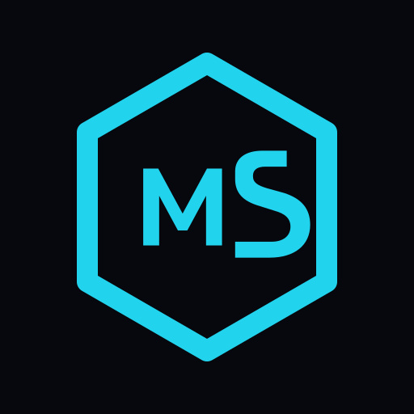

<p align="center">
  
</p>

<h1 align="center">Mohammed Sufyan</h1>

<p align="center">
  <strong>Software Engineer · Cisco Systems Inc. STO</strong><br/>
  Security data platforms · multi-cloud systems · applied AI
</p>

<p align="center">
  <a href="https://www.mohammedsufyan.com/"><strong>Live site</strong></a>
  ·
  <a href="https://www.linkedin.com/in/mohammed-sufyan">LinkedIn</a>
  ·
  <a href="./docs/CI.md">CI</a>
  ·
  <a href="./docs/ARCHITECTURE.md">Architecture</a>
  ·
  <a href="./docs/SECURITY.md">Security</a>
</p>

<p align="center">
  <a href="https://github.com/mosufyan/sufyan-portfolio/actions/workflows/ci.yml"></a>
  <a href="https://www.mohammedsufyan.com/"></a>
  <a href="./package.json"></a>
  
</p>

<p align="center">
  <a href="https://www.mohammedsufyan.com/og-card.svg?track=executive&theme=dark">
    
  </a>
</p>

---

Interactive portfolio and operations console: skill-filtered experience, OTP-gated contact & CV studio, Vector RAG chat (optional Grok), Portfolio Architecture map (`#architecture`), and a full owner governance + **Portfolio CMS** — deployed on **Cloud Run**.

## Highlights

| | |
|---|---|
| **Portfolio** | Multi-skill filters, `⌘K` command palette, `sufyanctl` CLI, dark / light themes, digital card |
| **Leads** | Contact + CV export with email OTP, Turnstile, honeypot, owner triage inbox |
| **Chat** | OTP welcome, Upstash Vector RAG, optional Grok enrichment, live-agent handoff, dual voice (PTT + Live S2S) |
| **Owner console** | Google Sign-In, analytics, CRM/alerts, **Portfolio CMS** (certs · honors · recs · skills · experience), announcements, delegates, incident mode, audit log |
| **Architecture map** | Interactive `#architecture` / `#security` hub — platform, security layers, Mermaid flows, live readiness |
| **Observability** | Request IDs, JSON logs, Sentry/Slack hooks, Prometheus `GET /api/metrics`, `/api/status` readiness snapshot |
| **Delivery** | Separate CI checks: SemVer · typecheck · Vitest/coverage · CSP · bundle size · rules · Gitleaks · Bandit/Semgrep · CodeQL · Trivy · Cloud Run on `main` — [docs/CI.md](./docs/CI.md) |

## Stack

<p align="center">
  
  
  
  
  
  
  
</p>

| Layer | Choices |
|-------|---------|
| **UI** | React 19 · Vite 8 · Tailwind 4 · Motion · Recharts |
| **API** | Express (OTP, chat, owner policy, telemetry, dynamic OG) |
| **Data** | Firebase Auth + Firestore (strict rules) |
| **AI / cache** | Upstash Vector + Redis · optional xAI Grok |
| **Host** | Cloud Run · GitHub Actions (Workload Identity) |

## Quick start

**Requires** Node.js 22+ and npm 10+.

```bash
git clone https://github.com/mosufyan/sufyan-portfolio.git
cd sufyan-portfolio
npm install
cp .env.example .env   # optional — needed for live OTP / Turnstile / chat
npm run dev
```

Open [http://localhost:3000](http://localhost:3000).

| Script | Purpose |
|--------|---------|
| `npm run dev` | Express + Vite local server |
| `npm run build` / `npm start` | Production build + serve |
| `npm test` / `npm run lint` | Vitest · TypeScript |
| `npm run test:coverage` | Coverage + thresholds |
| `npm run test:rules` | Firestore rules tests (emulator) |
| `npm run ci:csp-smoke` | Assert prod CSP / security headers |
| `npm run precommit` | Gitleaks + typecheck + rules lint |
| `npm run release -- 1.1.20` | SemVer bump + annotated `v*` tag |

> PRs fail if `package.json` still uses an already-released `v*` tag (**SemVer tag** check) — bump before merge. After a green deploy on `main`, CI publishes the matching GitHub Release. Full CI check list: [docs/CI.md](./docs/CI.md).

## Docs

| Doc | Topic |
|-----|--------|
| [CI](./docs/CI.md) | Each GitHub Actions check — what / why / how |
| [Architecture](./docs/ARCHITECTURE.md) | System layout, APIs, data flow |
| [Security](./docs/SECURITY.md) | Threat model & hardening notes |
| [Security configuration](./docs/SECURITY_CONFIGURATION.md) | Env, secrets, operational controls |
| [External tools & costs](./docs/EXTERNAL_TOOLS_AND_COSTS.md) | Firebase, Upstash, Grok, Cloudflare, GCP |
| [Portfolio assessment](./docs/PORTFOLIO_ASSESSMENT.md) | Maturity scores, gaps, ops checklist |

## Layout

```text
src/                 React UI · Owner Console · CMS · Chat · Resume Studio · Architecture map
server.ts            Express APIs + SPA hosting (+ /api/metrics)
server/              Security, chat, vector, Grok, observability
docs/                Architecture · security · CI · costs · assessment
firestore.rules      Default-deny schema-validated rules (CMS + seed hides)
firestore.indexes.json  Announcements + CMS deleted/updatedAt composites
.github/workflows/   CI gates · Trivy · Cloud Run deploy · releases
```

## License

Private portfolio source. All rights reserved © Mohammed Sufyan.
