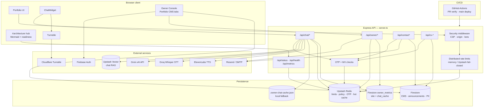
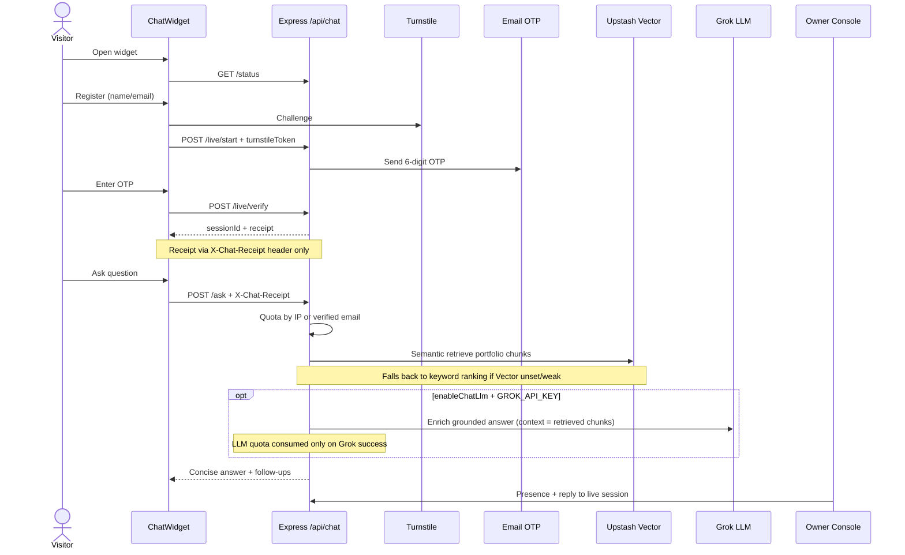
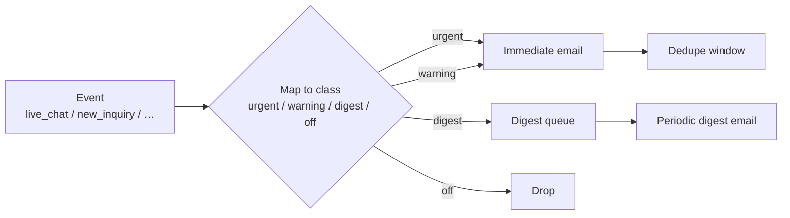
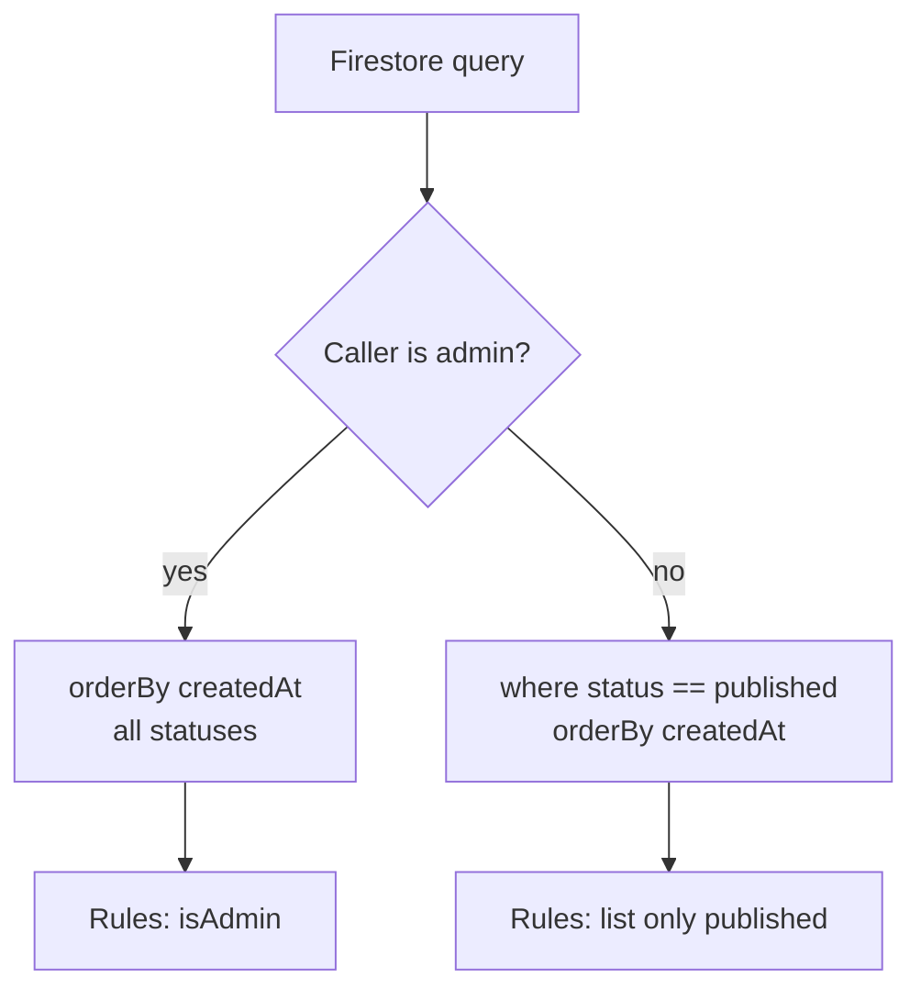
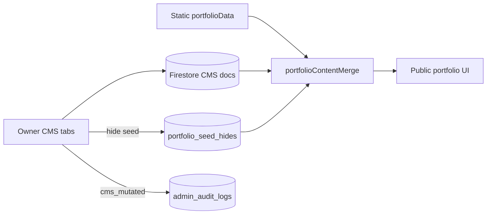
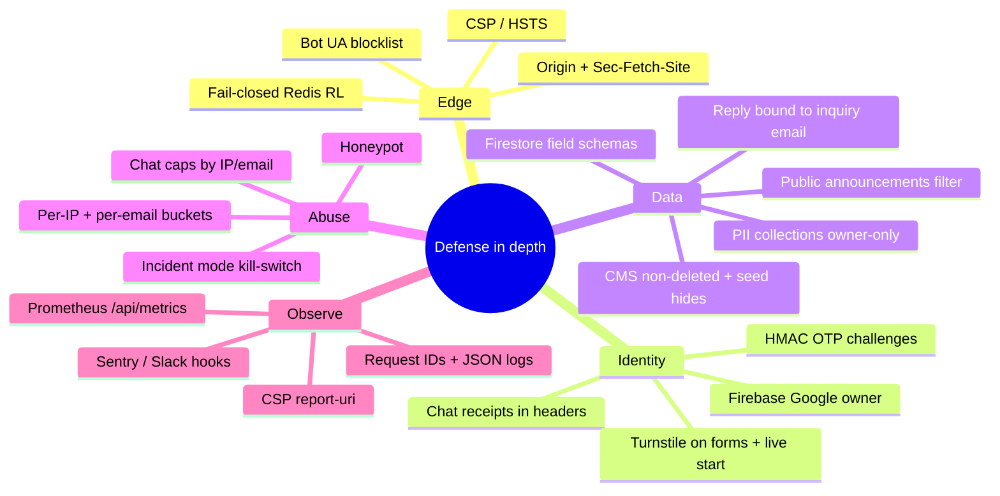

# Portfolio Architecture

Living documentation for the Mohammed Sufyan portfolio — React/Vite client, Express API, Firebase Auth/Firestore, Portfolio CMS, and owner governance.

Related: [SECURITY.md](./SECURITY.md) · [SECURITY_CONFIGURATION.md](./SECURITY_CONFIGURATION.md) · [EXTERNAL_TOOLS_AND_COSTS.md](./EXTERNAL_TOOLS_AND_COSTS.md) · [PORTFOLIO_ASSESSMENT.md](./PORTFOLIO_ASSESSMENT.md) · [CI.md](./CI.md) · [README](../README.md)

---

## System overview



---

## Chat & live agent flow



### Chat retrieval modes

| Mode | When | Behavior |
|------|------|----------|
| Keyword | Vector unset / weak scores | Score curated `portfolioData` chunks |
| Vector | `UPSTASH_VECTOR_*` set | Upstash Vector + BGE embeddings; hybrid merge with keyword |
| Grok enrich | Owner `enableChatLlm` + `GROK_API_KEY` | Rewrite from retrieved context; else show grounded text |
| LLM off | Toggle off | Vector/keyword answer only — no `api.x.ai` calls |

### Voice agent (dual path)

```mermaid
sequenceDiagram
  actor V as Visitor
  participant W as ChatWidget
  participant T as VoiceTransport
  participant API as Express voice turn
  participant Groq as GroqWhisper
  participant Vec as UpstashVector
  participant LLM as Grok
  participant EL as ElevenLabs
  participant Live as Grok Live S2S

  alt Push-to-talk
    V->>W: Hold mic / release
    W->>T: submitUtterance blob
    Note over T: HttpTurnTransport
    T->>API: POST /api/chat/voice/turn multipart
    API->>Groq: Transcribe
    API->>Vec: RAG retrieve
    opt enableChatLlm
      API->>LLM: Enrich
    end
    opt ELEVENLABS_API_KEY
      API->>EL: TTS Flash
    end
    API-->>W: transcript + answer + optional audio
  else Live S2S
    V->>W: Start Live Call
    W->>Live: wss://api.x.ai (CSP allowlisted)
    Note over W,Live: Realtime speech; gated by enableVoiceRealtime
  end
```

| Piece | Detail |
|-------|--------|
| PTT gate | Owner `enableVoiceAgent` + `GROQ_API_KEY` → `voiceAgentAvailable` on `/api/chat/status` |
| Live S2S | Owner `enableVoiceRealtime` + Grok Live; production CSP allows `wss://api.x.ai` |
| Quotas | Consumes **voice** + **question** counters (`chatMaxVoiceTurnsPerVisitor`, default 8) |
| Client abstraction | `VoiceTransport` in `src/utils/voiceTransport.ts` — `HttpTurnTransport` for PTT; Live Call uses Grok WebSocket |
| Owner Console | PTT transcripts append with `channel: ptt`; Live S2S start notice + captions via `/api/chat/voice/realtime-log` (`channel: s2s`); thread filter chips All/Text/PTT/S2S |

### Quota keys (anti-spoof)

| Visitor state | Quota key material |
|---------------|--------------------|
| Anonymous | `sha256(ip:…)` |
| OTP-verified | `sha256(email:…)` |
| Client `visitorId` | **Ignored** for quotas (spoofable) |

---

## Owner alert routing



Configured in Owner Profile → Alert notify prefs (`alertClass*`, `alertEmail*`).

---

## Announcements visibility



Composite index: `announcements` — `status` ASC + `createdAt` DESC (`firestore.indexes.json`).

---

## Portfolio CMS

Owner Console hub at `#owner/cms/<tab>` (legacy hashes still resolve). Seed data in `portfolioData` merges with Firestore overrides; soft-delete of seeds uses `portfolio_seed_hides` markers (no content tombstones).



| Collection | Public read | Admin write notes |
|------------|-------------|-------------------|
| `portfolio_certifications` / `_awards` / `_recommendations` / `_disciplines` | Non-deleted only (`deleted == false`) | Schema-validated; soft-delete via `deleted` or seed hide |
| `portfolio_seed_hides` | Yes (markers only) | Admin create/delete; `collection` + `entityId` |
| `portfolio_experience` | Yes | Keys `cisco` / `hcl` / `tcs`; deep `roles[]` validation |
| `portfolio_cisco_role` | Yes | Singleton `current` |

Composite indexes: each CMS collection — `deleted` ASC + `updatedAt` DESC.

Interactive control map for recruiters: `#architecture` / `#security` (Mermaid flows, layer pills, live `/api/status` readiness).

---

## Observability surface

| Endpoint | Audience | Contents |
|----------|----------|----------|
| `GET /api/status` | Public | Controls, bot protection, gold-path score, `observability` snapshot, `metricsPath` |
| `GET /api/health` | Ops | Gold-path checklist; may 503 under `STRICT_PROD_HARDENING` |
| `GET /api/metrics` | Scrapers / ops | Prometheus counters (OTP, chat RAG/LLM, voice, CSP, HTTP); optional `METRICS_TOKEN` |
| `GET /api/uptime` | External monitors | Lightweight probe |
| `GET /api/owner/observability` | Owner | Authenticated richer view |

---

## Module map

| Path | Responsibility |
|------|----------------|
| `server.ts` | HTTP routes, OTP, chat, owner reply binding, health/status/uptime/metrics |
| `server/security.ts` | Headers, CSP reports, Turnstile, honeypot, origin checks |
| `server/distributedStore.ts` | Upstash rate limits (fail-closed), policy, OTP/session KV helpers |
| `server/telemetry.ts` | IP/ASN risk, MX/phone checks, Redis-backed OTP bridge |
| `server/observability.ts` | Request IDs, structured logs, Prometheus counters, Sentry/Slack hooks |
| `server/chatLimits.ts` | Per-visitor question / LLM / live caps (Redis-shared) |
| `server/chatKnowledge.ts` | Curated knowledge chunks + keyword ranking + concise answers |
| `server/portfolioVector.ts` | Upstash Vector RAG (embed/sync/query) + keyword hybrid fallback |
| `server/grokLlm.ts` | Optional Grok (xAI) chat-completions enrichment |
| `.github/workflows/ci.yml` | Separate PR checks (SemVer, typecheck, tests, coverage, CSP, bundle size, rules, SAST, Docker/Trivy); `main`: deploy Cloud Run — see [CI.md](./CI.md) |
| `scripts/ci-bundle-size.mjs` | JS budget (~6.5 MiB total / ~3.0 MiB largest; Mermaid lazy chunks) |
| `scripts/wire-chat-llm-secrets.sh` | Upsert Grok/Vector secrets → Secret Manager + Cloud Run |
| `scripts/setup-github-actions-deploy.sh` | One-time WIF + deploy SA for GitHub → Cloud Run |
| `server/chatSessions.ts` | Live session store + disk + Redis hot cache + Firestore `owner_metrics/chat_cache` |
| `server/ownerDurableState.ts` | Merge/sanitize helpers for durable pageviews / OG / chat snapshots |
| `owner_metrics/*` (Firestore) | Durable `site` (pageviews/OG) + `chat_cache` (sessions/counters); Admin SDK write, owner read |
| `server/chatReceipt.ts` | Header-based session receipt extraction |
| `server/ownerNotify.ts` | Urgent / warning / digest router |
| `server/firebaseAdmin.ts` | Admin SDK PII writes + inquiry reply binding |
| `src/components/ChatWidget.tsx` | Visitor chat UI + Turnstile + dual voice |
| `src/components/OwnerConsolePage.tsx` | Full-page owner console + Portfolio CMS hub |
| `src/components/SecurityArchitectureModal.tsx` | Portfolio Architecture map (`#architecture` / `#security`) |
| `src/components/SecurityMermaidChart.tsx` | Lazy Mermaid + DOMPurify SVG sanitize |
| `src/contexts/PortfolioContentContext.tsx` | CMS listeners, seed hides, `cms_mutated` audits |
| `src/utils/portfolioContentMerge.ts` | Seed + cloud merge / soft-delete semantics |
| `src/utils/ownerConsoleRouting.ts` | `#owner/cms/<tab>` + legacy hash parse |
| `src/utils/ownerGovernance.ts` | Settings sanitize + access rules + feature toggles |
| `firestore.rules` | Deny-by-default; CMS public non-deleted; Admin-only PII creates |
| `firestore.indexes.json` | Announcements + CMS `deleted`+`updatedAt` composites |
| `docs/` | Architecture, security config, costs, assessment, CI |

---

## Security control summary



---

## Test layout

| Suite | Covers |
|-------|--------|
| `server/*.test.ts` | Security, chat limits/receipts/sessions/knowledge, Vector RAG, Grok LLM, notify, Redis, voice |
| `src/utils/*.test.ts` | Governance, announcements, CV/ATS, phone, skills, tracking, routing |
| `src/theme/*.test.ts` | Theme/accent packs (including amber hover-remap regression) |
| `firestore.rules.test.ts` | Firestore rules unit tests (emulator via `npm run test:rules`) |

| Script | Purpose |
|--------|---------|
| `npm test` | Unit tests (Vitest) |
| `npm run test:coverage` | Coverage + thresholds (`server/`, `src/utils/`, `src/theme/`) |
| `npm run test:rules` | Firestore rules tests under Firebase emulator |
| `npm run lint` | TypeScript (`tsc --noEmit`) |
| `npm run lint:rules` | Firestore rules ESLint |
| `npm run security:audit` | Production dependency audit |
| `npm run ci:csp-smoke` | Start prod server; assert CSP / security headers |
| `npm run ci:bundle-size` | JS asset size budgets |

---

## CI/CD

Full per-check documentation: **[CI.md](./CI.md)**.

Each item below is a **separate GitHub Actions check** (`.github/workflows/ci.yml`):

| Check | When | What |
|-------|------|------|
| **SemVer tag** | PR only | Fail if `package.json` version already has a released `v*` tag |
| **Typecheck** | PR + `main` | `tsc --noEmit` |
| **Firestore rules lint** | PR + `main` | ESLint on `*.rules` + `firestore.indexes.json` validate |
| **Unit tests** | PR + `main` | Vitest |
| **Coverage** | PR + `main` | Vitest coverage thresholds |
| **npm audit** | PR + `main` | High+ production advisories |
| **Production build** | PR + `main` | Vite build → `dist` artifact |
| **CSP headers smoke** | PR + `main` | Live prod CSP must include `wss://api.x.ai`, `media-src`, core headers |
| **Bundle size** | PR + `main` | JS asset budgets (~6.5 MiB total) |
| **Firestore rules tests** | PR + `main` | Emulator + `@firebase/rules-unit-testing` |
| **Gitleaks** | PR + `main` | Secret scan (working tree) |
| **Bandit** | PR + `main` | Python SAST (if any `.py`) |
| **Semgrep** | PR + `main` | JS/TS security-audit rulesets |
| **Code Guard (CodeQL)** | PR + `main` | CodeQL analyze |
| **Docker build** | After gates | Local image (no push) |
| **Trivy scan** | After Docker | CRITICAL/HIGH image vulns |
| **Deploy Cloud Run** | `main` push only | WIF → Firestore rules/indexes deploy → Cloud Run image + smoke + GitHub Release |

Auth: GitHub secrets `GCP_WORKLOAD_IDENTITY_PROVIDER` + `GCP_SERVICE_ACCOUNT`; vars `GCP_PROJECT` / `GCP_REGION` / `CLOUD_RUN_SERVICE`.
