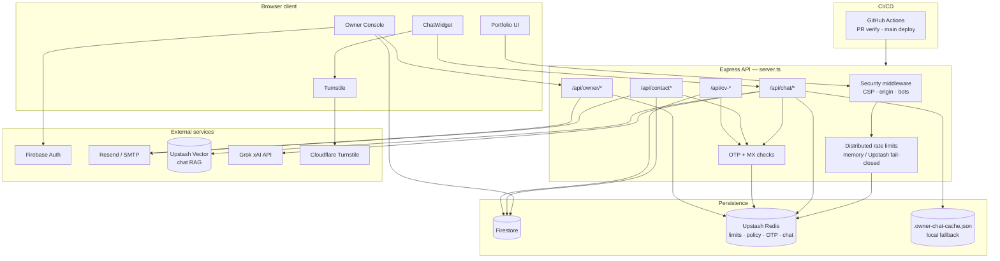
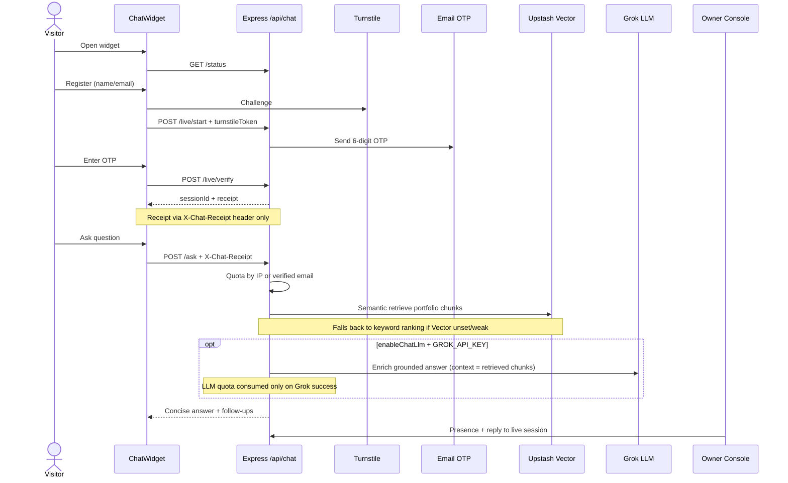
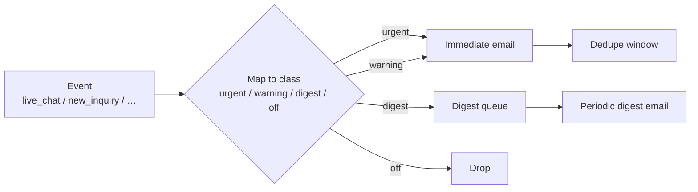
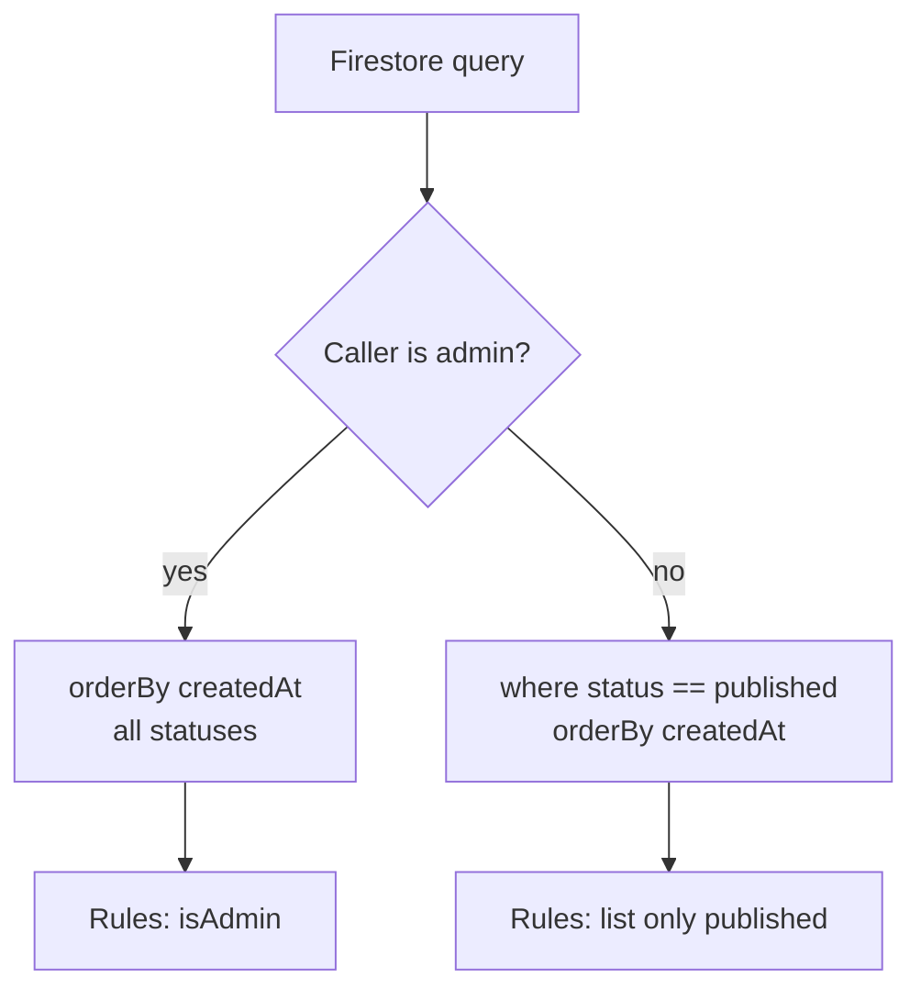
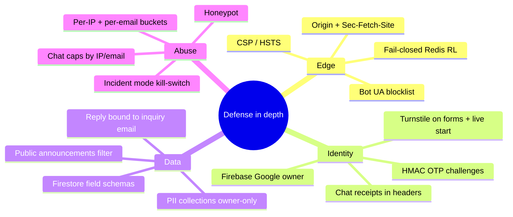

# Portfolio Architecture

Living documentation for the Mohammed Sufyan portfolio — React/Vite client, Express API, Firebase Auth/Firestore, and owner governance.

Related: [SECURITY.md](./SECURITY.md) · [SECURITY_CONFIGURATION.md](./SECURITY_CONFIGURATION.md) · [EXTERNAL_TOOLS_AND_COSTS.md](./EXTERNAL_TOOLS_AND_COSTS.md) · [PORTFOLIO_ASSESSMENT.md](./PORTFOLIO_ASSESSMENT.md) · [README](../README.md)

---

## System overview

---

## Chat & live agent flow

### Chat retrieval modes

| Mode | When | Behavior |
|------|------|----------|
| Keyword | Vector unset / weak scores | Score curated `portfolioData` chunks |
| Vector | `UPSTASH_VECTOR_*` set | Upstash Vector + BGE embeddings; hybrid merge with keyword |
| Grok enrich | Owner `enableChatLlm` + `GROK_API_KEY` | Rewrite from retrieved context; else show grounded text |
| LLM off | Toggle off | Vector/keyword answer only — no `api.x.ai` calls |

### Quota keys (anti-spoof)

| Visitor state | Quota key material |
|---------------|--------------------|
| Anonymous | `sha256(ip:…)` |
| OTP-verified | `sha256(email:…)` |
| Client `visitorId` | **Ignored** for quotas (spoofable) |

---

## Owner alert routing

Configured in Owner Profile → Alert notify prefs (`alertClass*`, `alertEmail*`).

---

## Announcements visibility

Composite index: `announcements` — `status` ASC + `createdAt` DESC (`firestore.indexes.json`).

---

## Module map

| Path | Responsibility |
|------|----------------|
| `server.ts` | HTTP routes, OTP, chat, owner reply binding, health/status/uptime |
| `server/security.ts` | Headers, CSP reports, Turnstile, honeypot, origin checks |
| `server/distributedStore.ts` | Upstash rate limits (fail-closed), policy, OTP/session KV helpers |
| `server/telemetry.ts` | IP/ASN risk, MX/phone checks, Redis-backed OTP bridge |
| `server/observability.ts` | Request IDs, structured logs, metrics, Sentry/Slack hooks |
| `server/chatLimits.ts` | Per-visitor question / LLM / live caps (Redis-shared) |
| `server/chatKnowledge.ts` | Curated knowledge chunks + keyword ranking + concise answers |
| `server/portfolioVector.ts` | Upstash Vector RAG (embed/sync/query) + keyword hybrid fallback |
| `server/grokLlm.ts` | Optional Grok (xAI) chat-completions enrichment |
| `.github/workflows/ci.yml` | PR: lint/test/audit/build + Docker; `main`: deploy Cloud Run |
| `scripts/wire-chat-llm-secrets.sh` | Upsert Grok/Vector secrets → Secret Manager + Cloud Run |
| `scripts/setup-github-actions-deploy.sh` | One-time WIF + deploy SA for GitHub → Cloud Run |
| `server/chatSessions.ts` | Live session store + disk cache + Redis write-through |
| `server/chatReceipt.ts` | Header-based session receipt extraction |
| `server/ownerNotify.ts` | Urgent / warning / digest router |
| `server/firebaseAdmin.ts` | Admin SDK PII writes + inquiry reply binding |
| `src/components/ChatWidget.tsx` | Visitor chat UI + Turnstile |
| `src/components/OwnerConsolePage.tsx` | Full-page owner console shell |
| `src/utils/ownerGovernance.ts` | Settings sanitize + access rules + feature toggles |
| `firestore.rules` | Deny-by-default collection rules (Admin-only PII creates) |
| `firestore.indexes.json` | Composite indexes (announcements, analytics queries) |
| `docs/` | Architecture, security config, costs, assessment |

---

## Security control summary

---

## Test layout

| Suite | Covers |
|-------|--------|
| `server/*.test.ts` | Security, chat limits/receipts/sessions/knowledge, Vector RAG, Grok LLM, notify, Redis |
| `src/utils/*.test.ts` | Governance, announcements, CV/ATS, phone, skills, tracking, routing |
| `src/utils/portfolioFeatures.test.ts` | Cross-feature matrix smoke |

Run: `npm test` · Lint: `npm run lint` · Audit: `npm run security:audit`

---

## CI/CD

| Event | Jobs |
|-------|------|
| **Pull request → `main`** | Lint · unit tests · `npm audit` · Vite build · Docker image build (no push) |
| **Push / merge → `main`** | Same verify + Docker, then **Cloud Run deploy** (`gcloud run deploy --source .`) via Workload Identity + smoke `GET /api/chat/status` |

Auth: GitHub secrets `GCP_WORKLOAD_IDENTITY_PROVIDER` + `GCP_SERVICE_ACCOUNT`; vars `GCP_PROJECT` / `GCP_REGION` / `CLOUD_RUN_SERVICE`.
