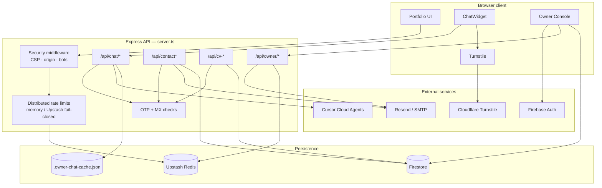
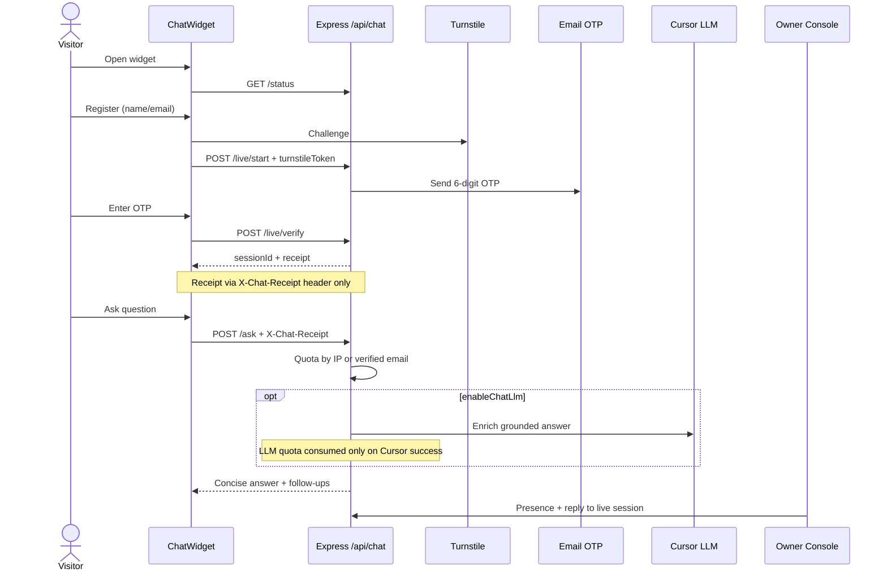
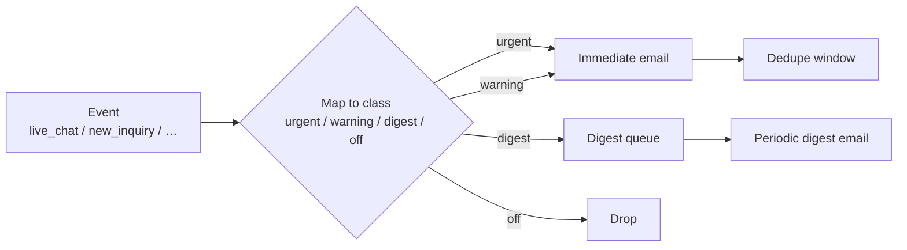
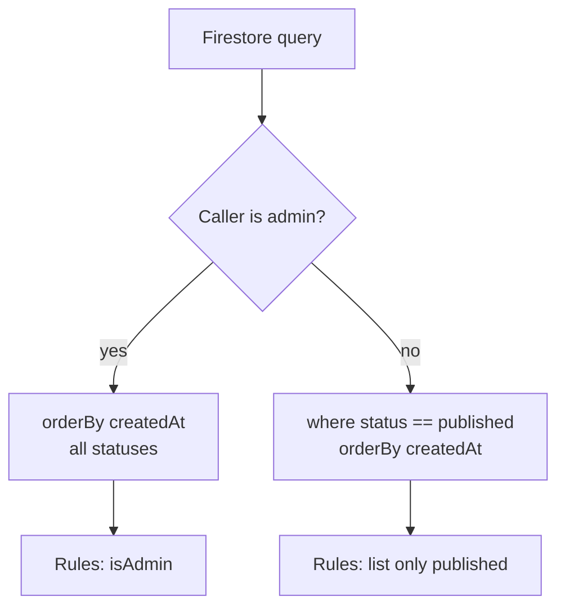
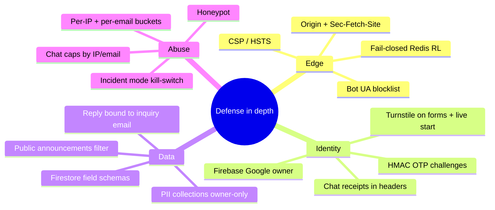

# Portfolio Architecture

Living documentation for the Mohammed Sufyan portfolio — React/Vite client, Express API, Firebase Auth/Firestore, and owner governance.

Related: [SECURITY.md](../SECURITY.md) · [SECURITY_CONFIGURATION.md](./SECURITY_CONFIGURATION.md) · [EXTERNAL_TOOLS_AND_COSTS.md](./EXTERNAL_TOOLS_AND_COSTS.md) · [README](../README.md)

---

## System overview

---

## Chat & live agent flow

### Quota keys (anti-spoof)

| Visitor state | Quota key material |
|---------------|--------------------|
| Anonymous | `sha256(ip:…)` |
| OTP-verified | `sha256(email:…)` |
| Client `visitorId` | **Ignored** for quotas (spoofable) |

---

## Owner alert routing

Configured in Owner Profile → Alert notify prefs (`alertClass*`, `alertEmail*`).

---

## Announcements visibility

Composite index: `announcements` — `status` ASC + `createdAt` DESC (`firestore.indexes.json`).

---

## Module map

| Path | Responsibility |
|------|----------------|
| `server.ts` | HTTP routes, OTP, chat, owner reply binding |
| `server/security.ts` | Headers, Turnstile, honeypot, origin checks |
| `server/distributedStore.ts` | Upstash rate limits (fail-closed) + policy |
| `server/chatLimits.ts` | Per-visitor question / LLM / live caps |
| `server/chatKnowledge.ts` | Grounded Q&A + concise answers |
| `server/cursorLlm.ts` | Optional Cursor Cloud Agents enrichment |
| `server/chatSessions.ts` | Live session store + disk cache |
| `server/chatReceipt.ts` | Header-based session receipt extraction |
| `server/ownerNotify.ts` | Urgent / warning / digest router |
| `server/firebaseAdmin.ts` | Admin SDK writes + inquiry reply binding |
| `src/components/ChatWidget.tsx` | Visitor chat UI + Turnstile |
| `src/utils/ownerGovernance.ts` | Settings sanitize + access rules |
| `firestore.rules` | Deny-by-default collection rules |

---

## Security control summary

---

## Test layout

| Suite | Covers |
|-------|--------|
| `server/*.test.ts` | Security, chat limits/receipts/sessions/knowledge, Cursor LLM, notify, Redis |
| `src/utils/*.test.ts` | Governance, announcements, CV/ATS, phone, skills, tracking, routing |
| `src/utils/portfolioFeatures.test.ts` | Cross-feature matrix smoke |

Run: `npm test` · Lint: `npm run lint` · Audit: `npm run security:audit`
