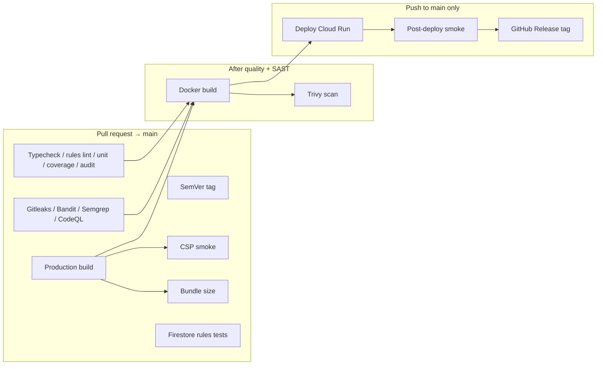

# Continuous Integration (CI)

Workflow: [`.github/workflows/ci.yml`](../.github/workflows/ci.yml)

Each row below is a **separate GitHub Actions check** so a SemVer or CSP failure is never mislabeled as “lint.”



---

## Triggers

| Event | What runs |
|-------|-----------|
| **Pull request → `main`** | All checks except Deploy |
| **Push / merge → `main`** | Same checks (SemVer skipped) + **Deploy Cloud Run** + release tag |

Concurrency: one run per branch/ref; newer PR pushes cancel in-progress runs.

---

## Checks (what / why / how)

### SemVer tag
- **Significance:** Stops shipping the same `package.json` version twice. Footer/`/api/health` version must match a fresh release.
- **How:** Reads `package.json` version → if `refs/tags/vX.Y.Z` already exists on `origin`, fails. **PR-only** (so `main` deploy can create the tag).
- **Fix:** Bump version (and lockfile) before merge.

### Typecheck
- **Significance:** Catches TypeScript breakage before runtime.
- **How:** `npm ci` → `npm run lint` (`tsc --noEmit`).

### Firestore rules lint
- **Significance:** Static lint of `firestore.rules` (deny-by-default schemas).
- **How:** `npm run lint:rules` (ESLint Firebase rules plugin).

### Unit tests
- **Significance:** Fast regression suite for server security, chat, voice, governance utils, theme accents.
- **How:** `npm test` (Vitest). Excludes emulator rules tests and any optional e2e.

### Coverage
- **Significance:** Keeps a floor on tested surface area for `server/`, `src/utils/`, `src/theme/`.
- **How:** `npm run test:coverage` with thresholds in `vitest.config.ts` (lines/functions/statements ≥ 50%, branches ≥ 40%).

### npm audit
- **Significance:** Blocks known **high+** vulnerabilities in production dependencies.
- **How:** `npm run security:audit` (`npm audit --omit=dev --audit-level=high`).

### Production build
- **Significance:** Proves the Vite SPA builds with client env baked in; feeds downstream smokes.
- **How:** `npm run build` with `VITE_*` secrets → uploads `dist` artifact.

### CSP headers smoke
- **Significance:** Catches production CSP regressions (e.g. Live S2S needing `wss://api.x.ai`, TTS `media-src`).
- **How:** Download `dist` → start Express (`npm start`) → `curl -sI /` → assert CSP / nosniff / Referrer-Policy / Permissions-Policy (`scripts/ci-csp-headers-smoke.sh`).

### Bundle size
- **Significance:** Guards accidental JS bloat that hurts first load.
- **How:** `scripts/ci-bundle-size.mjs` sums `dist/assets/*.js`; fails if total or largest chunk exceeds budget (**~6.5 MiB** total / **~3.0 MiB** largest — includes lazy Mermaid diagram chunks for `#architecture`).

### Firestore rules tests
- **Significance:** Behavioral proof of deny-by-default and public vs draft announcement reads.
- **How:** Java + Firebase emulator → `npm run test:rules` (`firestore.rules.test.ts` via `@firebase/rules-unit-testing`).

### Gitleaks (secrets)
- **Significance:** Stops accidental commit of API keys/tokens.
- **How:** Working-tree `gitleaks detect --no-git` with `.gitleaks.toml` (avoids permanent red from rotated historical secrets).

### Bandit check
- **Significance:** Python SAST if any tracked `.py` exists (no-op skip when none).
- **How:** `bandit -ll` on `git ls-files '*.py'`.

### Semgrep
- **Significance:** JS/TS security patterns (injection, unsafe APIs, etc.).
- **How:** `semgrep` with `p/javascript`, `p/typescript`, `p/security-audit`.

### Code Guard check (CodeQL)
- **Significance:** Deeper semantic vulnerability analysis for JS/TS.
- **How:** `github/codeql-action` init → autobuild → analyze (config under `.github/codeql/`).

### Docker build
- **Significance:** Proves the Cloud Run image builds (multi-stage Node slim).
- **How:** After quality + SAST gates → `docker/build-push-action` load locally → `docker save` artifact. Uses `.npmrc` (`legacy-peer-deps`) so `npm ci` matches CI/local.

### Trivy scan
- **Significance:** Blocks CRITICAL/HIGH OS/library/misconfig/secret findings in the image.
- **How:** Load saved image → `aquasecurity/trivy-action` with `exit-code: 1`.

### Deploy Cloud Run (`main` only)
- **Significance:** Production delivery after all gates.
- **How:** Workload Identity → build/push Artifact Registry image → `gcloud run deploy` → smoke `/api/uptime`, `/api/health`, `/api/status`, `/api/chat/status` + SPA Firebase `apiKey` bake check → create `v*` tag + GitHub Release if missing.

---

## Local equivalents

```bash
npm run lint
npm test
npm run test:coverage
npm run test:rules          # needs Java (Firestore emulator)
npm run security:audit
npm run build
npm run ci:csp-smoke        # needs dist/
npm run ci:bundle-size      # needs dist/
```

Pre-commit (Husky): Gitleaks + typecheck (+ rules lint when `*.rules` staged).

---

## Auth & secrets (deploy / build)

| Kind | Names |
|------|--------|
| Secrets | `GCP_WORKLOAD_IDENTITY_PROVIDER`, `GCP_SERVICE_ACCOUNT`, `VITE_FIREBASE_API_KEY`, `VITE_TURNSTILE_SITE_KEY`, `VITE_RECAPTCHA_SITE_KEY` |
| Vars | `GCP_PROJECT`, `GCP_REGION`, `CLOUD_RUN_SERVICE` |

One-time GCP WIF setup: `./scripts/setup-github-actions-deploy.sh`.

---

## Related docs

- [ARCHITECTURE.md](./ARCHITECTURE.md) — system layout + short CI table
- [SECURITY.md](./SECURITY.md) — threat model & CSP notes
- [SECURITY_CONFIGURATION.md](./SECURITY_CONFIGURATION.md) — env / ops checklists
- [EXTERNAL_TOOLS_AND_COSTS.md](./EXTERNAL_TOOLS_AND_COSTS.md) — Actions cost context

## Owner metrics durability (ops note)

Cloud Run disk is ephemeral. Lifetime pageviews/OG and chat sessions/counters now persist via:

1. **Firestore** `owner_metrics/site` + `owner_metrics/chat_cache` (Admin SDK; survives redeploys)
2. **Upstash Redis** hot cache (`owner:site-telemetry`, `owner:chat-cache`)
3. Local JSON only as a warm cache on the current container

Requires `FIREBASE_SERVICE_ACCOUNT_JSON` (or ADC) on Cloud Run so `serverTelemetryWrites` / Admin path is live. Confirm `/api/health` shows `distributedStore: "redis"` and `serverTelemetryWrites: true`.
