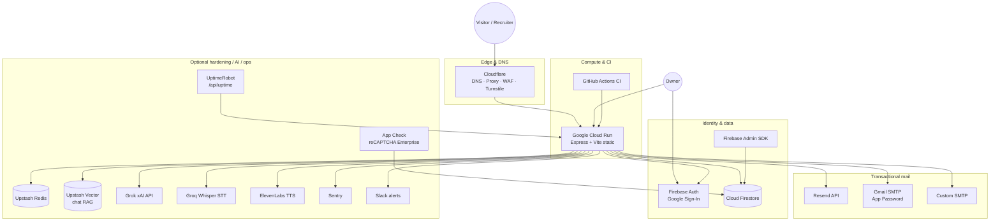
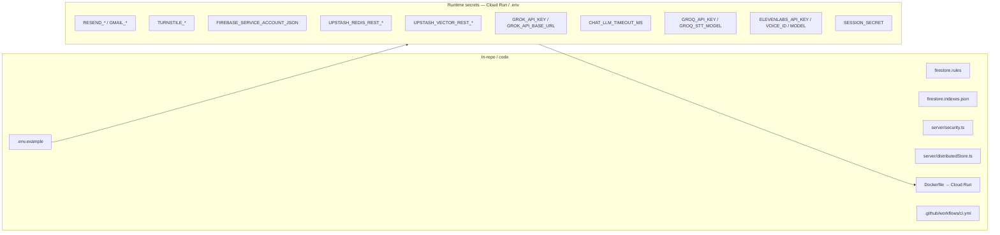
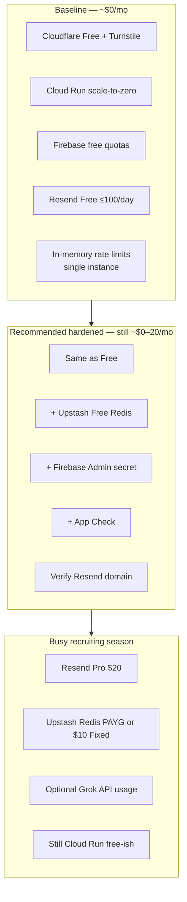
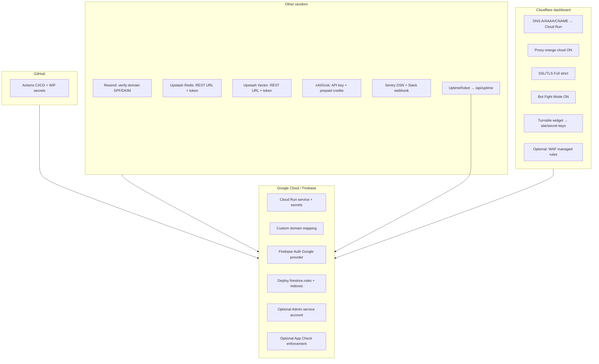
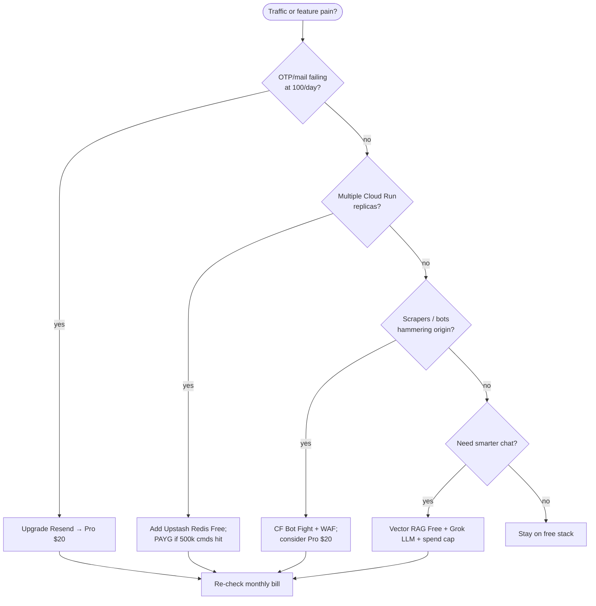

# External Tools, Configuration & Costs

Inventory of every third-party service used by **mohammedsufyan.com**, what is already configured in this repo, free-tier limits, and when/how to upgrade.

> **Pricing note:** Figures below are vendor-published list prices as of late 2026. Always re-check the linked pricing pages before budgeting. Currency is USD.

Related: [ARCHITECTURE.md](./ARCHITECTURE.md) · [SECURITY_CONFIGURATION.md](./SECURITY_CONFIGURATION.md) · [SECURITY.md](./SECURITY.md) · [`.env.example`](../.env.example)

---

## System map — what talks to what

---

## Tool inventory (what we use)

| # | Service | Role in this portfolio | Required? | Free tier usable? |
|---|---------|------------------------|-----------|-------------------|
| 1 | **Cloudflare** | DNS for domain, orange-cloud proxy, SSL, Bot Fight Mode, WAF, Turnstile widgets | Strongly recommended | Yes (Free plan + free Turnstile) |
| 2 | **Google Cloud Run** | Hosts Dockerized Express + built React app (scale-to-zero) | Yes (current deploy) | Yes (always-free allotment) |
| 3 | **Firebase Authentication** | Owner Google Sign-In for Owner Console | Yes | Yes (50K MAU free) |
| 4 | **Cloud Firestore** | Announcements, Portfolio CMS, portfolio settings, contact/CV logs, access rules, audit, seed hides | Yes | Yes (Spark/Blaze free quotas) |
| 5 | **Resend** *(or Gmail SMTP)* | OTP emails, inquiry mail, owner alerts/replies | Yes (one mail path) | Yes (Resend Free / Gmail personal) |
| 6 | **Cloudflare Turnstile** | Bot challenge on Contact, CV gate, live-chat start | Recommended | Yes (unlimited challenges on Free) |
| 7 | **Upstash Redis** | Shared rate limits, owner policy, OTP challenges, chat quotas/sessions across replicas | Recommended if >1 replica | Yes (1 DB, 500K cmds/mo) |
| 8 | **Upstash Vector** | Semantic RAG for portfolio chat (built-in BGE embeddings) | Optional (chat quality) | Yes (Free: 10K queries/day) |
| 9 | **Firebase Admin SDK** | Server-side PII writes after OTP; reply binding | Recommended | Included with Firebase/GCP |
| 10 | **Firebase App Check** | Attest browser before Firestore creates | Recommended | Free quotas (provider-dependent) |
| 11 | **Grok (xAI) API** | Optional chat answer enrichment over retrieved context | Optional | Pay-as-you-go / prepaid credits |
| 12 | **Groq Whisper** | Optional voice-agent speech-to-text (`GROQ_API_KEY`) | Optional (voice) | Yes (Free plan rate limits) |
| 13 | **ElevenLabs TTS** | Optional cloud voice replies (`ELEVENLABS_API_KEY`); browser TTS fallback | Optional (voice) | Yes (Free ~10k credits/mo) |
| 14 | **GitHub Actions** | Separate PR checks (SemVer, typecheck, tests, coverage, CSP, bundle size, rules, SAST, Docker/Trivy) + deploy Firestore rules/indexes + Cloud Run on `main` — [CI.md](./CI.md) | Yes | Yes (public repos generous) |
| 15 | **Artifact Registry / Cloud Build** | Used by Docker image push / Cloud Run deploy from Actions | Yes (with CD) | Small free/low cost |
| 16 | **Sentry** | Server error reporting (`SENTRY_DSN`) | Recommended (gold path) | Yes (Free developer tier) |
| 17 | **Slack** | Urgent/warning owner alerts (`SLACK_ALERT_WEBHOOK_URL`) | Recommended (gold path) | Workspace plan (webhook free) |
| 18 | **UptimeRobot** | External HTTP monitor on `GET /api/uptime` (5‑min checks, email on down) | Recommended (ops proof) | Yes (Free: 50 monitors) |
| 19 | **Google Domains / Registrar** | Domain registration (DNS may point at Cloudflare) | Domain ownership | At-cost renewal (not “free”) |
| 20 | **FormSubmit** | Legacy fallback only — **disabled by default** | No (`ALLOW_FORMSUBMIT_FALLBACK=false`) | N/A — keep off |

---

## Configuration already in the codebase

| Area | Configured how |
|------|----------------|
| Public URL / CORS | `APP_URL`, `resolveAllowedOrigins` |
| Trust real client IP | `TRUST_PROXY=1` behind Cloudflare / LB |
| Mail | Prefer `RESEND_API_KEY` + verified domain; else Gmail App Password; else SMTP |
| Turnstile | `TURNSTILE_SECRET_KEY` + `VITE_TURNSTILE_SITE_KEY` |
| OTP / sessions | HMAC via `SESSION_SECRET` (falls back to Turnstile secret if unset — set an explicit secret in prod) |
| Owner auth | Firebase project id from applet config; RS256 ID token verify |
| Firestore rules | Deny-by-default; owner/admin gates; announcements list = published; CMS public non-deleted + `portfolio_seed_hides` |
| Firestore indexes | Announcements composites + CMS `deleted`+`updatedAt` (`firestore.indexes.json`) |
| Rate limits / OTP / chat | In-memory (+ disk chat cache) by default; Upstash Redis when REST URL+token set (**fail-closed** on Redis errors) |
| Chat RAG | `UPSTASH_VECTOR_REST_*` → Vector retrieve; keyword fallback |
| Chat LLM | `GROK_API_KEY` + owner toggle `enableChatLlm` (default model `grok-4.3`) |
| Voice agent | PTT: `GROQ_API_KEY` + optional `ELEVENLABS_*` + `enableVoiceAgent`; Live S2S: `enableVoiceRealtime` + Grok (`wss://api.x.ai`) |
| Observability | `SENTRY_DSN`, `SLACK_ALERT_WEBHOOK_URL`, optional `METRICS_TOKEN` for `GET /api/metrics`; `STRICT_PROD_HARDENING=true` (plain env, not a secret) |
| External uptime | UptimeRobot → `https://www.mohammedsufyan.com/api/uptime` (expect HTTP 200; HEAD or GET) |
| CI/CD | Separate PR checks + indexes JSON validate; `main`: Firestore rules/indexes deploy + Cloud Run (WIF) — [CI.md](./CI.md) |

---

## Cost & limits by service

### 1. Cloudflare (DNS + edge security)

| Plan | Price | What you get for this site |
|------|-------|----------------------------|
| **Free** | **$0/mo** | DNS, CDN, Universal SSL, DDoS, **Bot Fight Mode**, basic WAF rules |
| **Pro** | ~$20/mo annual / $25 monthly | Super Bot Fight Mode, better WAF, image optimization, etc. |
| **Business** | ~$200/mo annual | PCI-oriented WAF, advanced rules, higher support |
| **Turnstile Free** | **$0** | Up to 20 widgets, unlimited challenges, 10 hostnames/widget |

**When limits hurt:** Free Bot Fight Mode is domain-wide and not finely skippable. Upgrade to **Pro** if legitimate automation (monitoring, LinkedIn scrapers you want) gets challenged incorrectly, or you need Super Bot Fight Mode categories.

**Recommended spend for this portfolio:** Stay on **Free** + Turnstile Free unless scrapers overwhelm origin.

---

### 2. Google Cloud Run (compute)

| Item | Free / included | After free |
|------|-----------------|------------|
| Requests | ~2M / month (request-based billing) | Per-request pricing |
| CPU / memory | 240k vCPU-sec + 450k GiB-sec / month (tier-1 regions) | Per-second billing |
| Idle | **Scale-to-zero** → $0 when no traffic | — |

**Portfolio impact:** A personal site with low QPS typically stays **~$0–few dollars/month**. Costs rise with always-on min instances, large memory, or multi-region.

**Upgrade path:** Keep `min-instances=0`. Add `min-instances=1` only if cold starts hurt OTP UX (~pays for always-warm CPU/RAM).

---

### 3. Firebase Auth + Firestore

| Product | Free quota | Paid (Blaze / GCP) |
|---------|------------|--------------------|
| **Auth (email/Google)** | 50K MAU | Then Identity Platform rates |
| **Firestore storage** | 1 GiB | Then ~$0.18/GiB-mo (region-dependent) |
| **Reads** | 50k / day | Then per-100k pricing |
| **Writes / deletes** | 20k / day each | Then per-100k pricing |
| **Egress** | 10 GiB / month | Then per-GiB |

**Portfolio impact:** Owner-only listeners + sparse lead docs stay inside free quota easily. Public announcement listeners, Portfolio CMS snapshots (non-deleted docs + seed hides), and settings snapshots are the main read drivers.

**If you exceed:** Enable Blaze (pay-as-you-go). Optimize with constrained queries (already: published-only announcements; CMS `deleted == false`). Move heavy analytics off real-time listeners if needed.

---

### 4. Resend (primary transactional mail)

| Plan | Price | Emails | Daily cap | Domains |
|------|-------|--------|-----------|---------|
| **Free** | **$0** | 3,000 / mo | **100 / day** | 3 |
| **Pro** | from **$20/mo** | 50k–100k | none | 10 |
| **Scale** | from **$90/mo** | 100k+ | none | 1,000 |
| API rate | all plans | — | **10 req/s** team-wide | — |

**What counts:** Each OTP, inquiry notification, owner reply, and alert email. Multi-recipient To/CC/BCC count per recipient.

**If you hit Free limits:** Sends fail (`daily_quota_exceeded` / monthly). Upgrade to **Pro $20** (no daily cap, 50k/mo) — right next step for a busy recruiting season.

**Alternative free path:** Gmail SMTP + App Password (Google account sending limits; not for high volume). Custom SMTP if you already pay for a mailbox host.

---

### 5. Cloudflare Turnstile

| Plan | Price | Limits |
|------|-------|--------|
| **Free** | **$0** | 20 widgets, unlimited challenges |
| Enterprise | Custom | Branding off, more hostnames, analytics |

**Upgrade trigger:** Almost never for a single portfolio — Free is enough.

---

### 6. Upstash Redis

| Plan | Price | Commands | Storage |
|------|-------|----------|---------|
| **Free** | **$0** | **500k / mo**, then reject | 250 MB, 1 DB |
| **Pay as you go** | **$0.20 / 100k cmds** | Soft scale | first 1 GB storage free, then $0.25/GB |
| **Fixed 250MB** | **$10/mo** | Unlimited cmds (plan cap) | 250 MB |

**Portfolio impact:** Each rate-limit / chat-quota check ≈ 1–2 Redis commands; OTP verify and live-chat session lookups add a few more when Redis is enabled. Free tier covers a busy personal site. Multi-replica Cloud Run without Redis falls back to **per-instance memory** (weaker OTP/session affinity).

**If Free commands exhaust:** Commands error → our code **fail-closes** (denies request). Upgrade to PAYG or Fixed $10.

---

### 7. Upstash Vector (optional chat RAG)

| Plan | Price | Limits relevant here |
|------|-------|----------------------|
| **Free** | **$0** | 10K queries/day, 10K updates/day, 1536 dims |
| **Pay as you go** | $0.40 / 100K requests + $0.25/GB | Unlimited daily queries |

**Portfolio impact:** One query per visitor chat question; re-upsert (~20 chunks) on boot/deploy. Free tier is enough for a personal site. Index uses Upstash-hosted **BGE_SMALL_EN_V1_5** embeddings (`data:` upsert/query — no separate embedding API).

**If unset / fails:** Keyword ranking over `portfolioData` continues.

---

### 8. Grok (xAI) API (optional chat LLM)

| Item | Cost model |
|------|------------|
| API access | Grok / xAI API key (`GROK_API_KEY`, typically `xai-…`) |
| Per request | Prepaid / list rates via `https://api.x.ai/v1` |
| Default model | `grok-4.3` (override with Owner `chatLlmModel`) |
| Controls | Owner Profile caps (`chatMaxLlmPerVisitor`) + `CHAT_LLM_TIMEOUT_MS` |
| If unset / fails | Retrieved grounded answer continues; **no charge** |

**Upgrade / control:** Keep `enableChatLlm` off until needed. Set low per-visitor LLM caps. Monitor spend in the xAI / Grok console. Wire secrets: `./scripts/wire-chat-llm-secrets.sh`.

---

### 9. Groq Whisper (optional voice STT)

| Item | Free plan (typical) |
|------|---------------------|
| Models | `whisper-large-v3-turbo` (default), `whisper-large-v3` |
| Requests | ~20 RPM, ~2,000 RPD |
| Audio | ~7,200 s/hour, ~28,800 s/day |
| File size | 25 MB free tier |

**Portfolio impact:** One STT call per push-to-talk turn. Owner `chatMaxVoiceTurnsPerVisitor` (default 8) keeps a public site inside free limits.

**If unset / fails:** Voice agent stays unavailable (`voiceAgentAvailable: false`). Text chat continues.

**Upgrade trigger:** Hit daily RPD during a recruiting surge → upgrade Groq Developer (pay-as-you-go) or lower the voice-turn cap.

---

### 10. ElevenLabs TTS (optional voice replies)

| Item | Free plan (typical) |
|------|---------------------|
| Credits | ~10,000 / month (~minutes of speech) |
| Recommended model | `eleven_flash_v2_5` (stretches credits) |
| Fallback | Browser `speechSynthesis` when key unset, 429, or error |

**Portfolio impact:** Short grounded answers (1–3 sentences) keep free credits viable. Attribution / personal-use terms apply on Free; Starter (~$6/mo) if you need clear commercial rights.

**If unset / fails:** Voice turns still work; client speaks the answer with browser TTS.

**Upgrade trigger:** Monthly credit exhaustion → Starter plan or rely on browser TTS only.

---

### 11. GitHub Actions (CI/CD)

| Repo visibility | Typical cost |
|-----------------|--------------|
| Public | Free Actions minutes for standard CI/CD |
| Private | Included minutes then pay-as-you-go |

**Workflow (`.github/workflows/ci.yml`) — each row is its own check:**

| Check | Notes |
|-------|--------|
| SemVer tag | PR-only; blocks reuse of an already-released `v*` |
| Typecheck / Firestore rules lint / Unit tests / Coverage | Fast quality gates |
| npm audit | Production deps, high+ |
| Production build | Uploads `dist` for downstream smokes |
| CSP headers smoke | Asserts prod CSP includes `wss://api.x.ai` + core headers |
| Bundle size | JS asset budgets (~6.5 MiB total / ~3.0 MiB largest) |
| Firestore rules tests | Java + Firebase emulator |
| Gitleaks / Bandit / Semgrep / CodeQL | Secret + SAST |
| Docker build → Trivy | Image artifact then CRITICAL/HIGH scan |
| Deploy Firestore + Cloud Run | **`main` only** — WIF → `firebase deploy` rules/indexes → image deploy + smoke + GitHub Release |

One-time GCP setup: `./scripts/setup-github-actions-deploy.sh` (deploy SA + WIF + `firebaserules.admin` / `datastore.indexAdmin`). GitHub secrets: `GCP_WORKLOAD_IDENTITY_PROVIDER`, `GCP_SERVICE_ACCOUNT`.

---

### 12. UptimeRobot (external uptime)

| Plan | Price | Limits relevant here |
|------|-------|----------------------|
| **Free** | **$0** | 50 monitors, **5‑min** interval, email alerts |
| Paid | from ~$7/mo | Faster intervals, SMS/voice, status pages |

**Portfolio config (live):**
- Monitor URL: `https://www.mohammedsufyan.com/api/uptime`
- Method: **HEAD** (Express `app.get` also answers HEAD) or GET
- Expect: **HTTP 2xx** (with `STRICT_PROD_HARDENING=true`, gold-path gaps return **503**)
- Alerts: email → `sufyan.net@gmail.com`

**When it pages:** Cloud Run down, edge failure, or gold-path incomplete under strict mode.

**Upgrade trigger:** Almost never for a personal portfolio — Free is enough.

---

### 13. Sentry + Slack (observability)

| Service | Free usable? | Role |
|---------|--------------|------|
| **Sentry** | Yes (developer) | `SENTRY_DSN` — server exceptions |
| **Slack** | Incoming webhook | `SLACK_ALERT_WEBHOOK_URL` — urgent/warning owner alerts |

Wired via Secret Manager → Cloud Run (`./scripts/wire-observability-secrets.sh`).

---

## Monthly cost scenarios (illustrative)

| Scenario | Approx monthly | Notes |
|----------|----------------|-------|
| **Baseline (current code, free vendors)** | **~$0** | Single Cloud Run instance, Resend Free, no Grok LLM |
| **Hardened free stack** | **~$0** | Add Upstash Redis Free + Vector Free + Admin SDK + App Check + CF Bot Fight |
| **Active hiring inbox** | **~$20–40** | Resend Pro; maybe Upstash Redis Fixed; light Grok usage |
| **Always-warm + LLM chat** | **$50+** | Cloud Run min instances + Grok prepaid + mail |

---

## What to configure where (checklist)

Detailed click-path steps: **[SECURITY_CONFIGURATION.md](./SECURITY_CONFIGURATION.md)**.

---

## Env var → service map

| Env var | Service | Free? |
|---------|---------|-------|
| `APP_URL` | Site identity / CORS | — |
| `TRUST_PROXY` | Cloudflare / LB | — |
| `SESSION_SECRET` | Local crypto | — |
| `RESEND_API_KEY` / `RESEND_FROM_EMAIL` | Resend | Free tier |
| `GMAIL_USER` / `GMAIL_APP_PASSWORD` | Google mail | Free personal limits |
| `SMTP_*` | Custom mail | Varies |
| `TURNSTILE_SECRET_KEY` / `VITE_TURNSTILE_SITE_KEY` | Cloudflare Turnstile | Free |
| `FIREBASE_SERVICE_ACCOUNT_JSON` | Firebase Admin | Free w/ project |
| `VITE_RECAPTCHA_SITE_KEY` | App Check | Free quotas |
| `UPSTASH_REDIS_REST_URL` / `_TOKEN` | Upstash Redis | Free tier |
| `UPSTASH_VECTOR_REST_URL` / `_TOKEN` | Upstash Vector | Free tier |
| `GROK_API_KEY` / `GROK_API_BASE_URL` | Grok (xAI) | Paid / prepaid |
| `CHAT_LLM_TIMEOUT_MS` | Grok client timeout | — |
| `GROQ_API_KEY` / `GROQ_STT_MODEL` | Groq Whisper STT | Free tier |
| `ELEVENLABS_API_KEY` / `ELEVENLABS_VOICE_ID` | ElevenLabs TTS | Free credits |
| `SENTRY_DSN` | Sentry errors | Free tier |
| `SLACK_ALERT_WEBHOOK_URL` | Slack urgent/warning | Workspace plan |
| `METRICS_TOKEN` | Gate `GET /api/metrics` | — |
| `STRICT_PROD_HARDENING` | Fail health if gold path incomplete | — |
| `CSP_STRICT_STYLES` | Enforce style-src elem/attr split | — |
| `ALLOW_FORMSUBMIT_FALLBACK` | FormSubmit | **Keep `false`** |

---

## Decision guide — when to upgrade

---

## Sources (verify before purchase)

- [Resend pricing](https://resend.com/pricing)
- [Upstash Redis pricing](https://upstash.com/pricing/redis)
- [Upstash Vector pricing](https://upstash.com/pricing/vector)
- [Cloudflare plans](https://www.cloudflare.com/plans/) · [Turnstile plans](https://developers.cloudflare.com/turnstile/plans/)
- [Firebase pricing](https://firebase.google.com/pricing)
- [Cloud Run pricing](https://cloud.google.com/run/pricing)
- [xAI / Grok API](https://x.ai/api) · [xAI docs](https://docs.x.ai/)
- [GitHub Actions](https://docs.github.com/en/actions)
- [UptimeRobot](https://uptimerobot.com) · [Sentry](https://sentry.io) · [Slack incoming webhooks](https://api.slack.com/messaging/webhooks)
