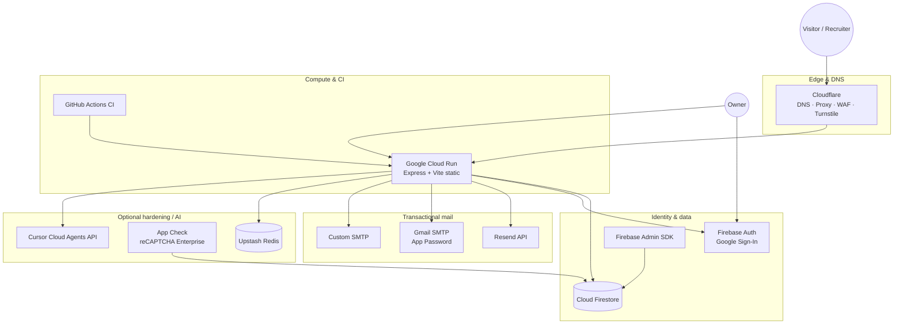
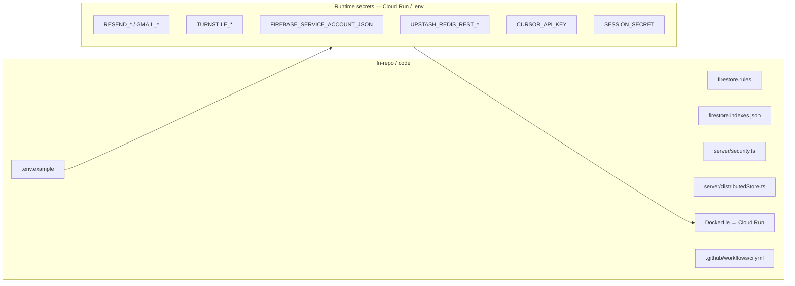
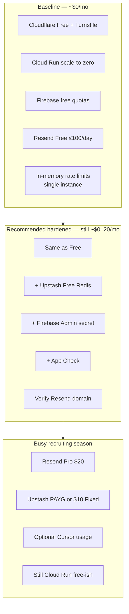
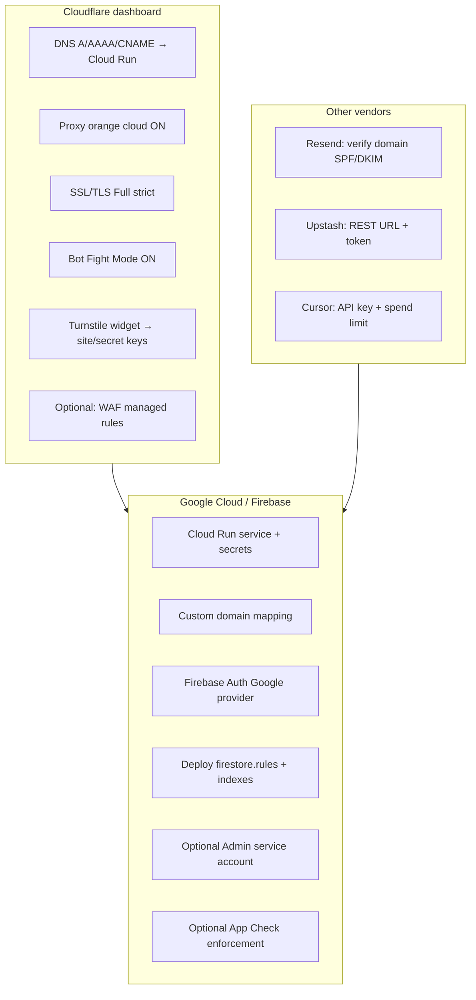
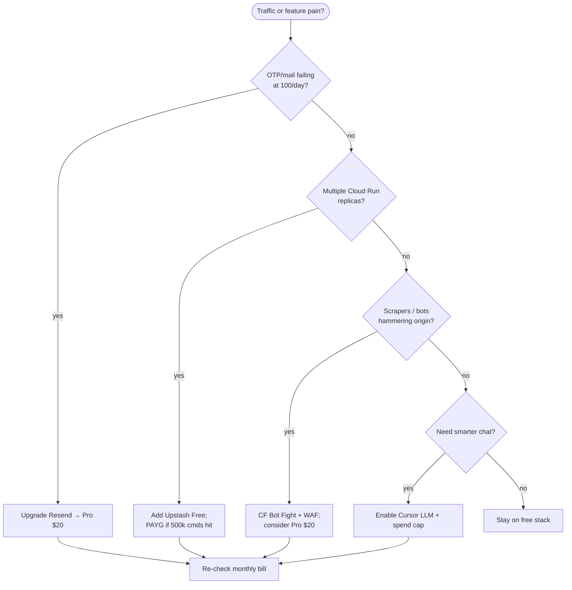

# External Tools, Configuration & Costs

Inventory of every third-party service used by **mohammedsufyan.com**, what is already configured in this repo, free-tier limits, and when/how to upgrade.

> **Pricing note:** Figures below are vendor-published list prices as of late 2026. Always re-check the linked pricing pages before budgeting. Currency is USD.

Related: [ARCHITECTURE.md](./ARCHITECTURE.md) · [SECURITY_CONFIGURATION.md](./SECURITY_CONFIGURATION.md) · [SECURITY.md](../SECURITY.md) · [`.env.example`](../.env.example)

---

## System map — what talks to what

---

## Tool inventory (what we use)

| # | Service | Role in this portfolio | Required? | Free tier usable? |
|---|---------|------------------------|-----------|-------------------|
| 1 | **Cloudflare** | DNS for domain, orange-cloud proxy, SSL, Bot Fight Mode, WAF, Turnstile widgets | Strongly recommended | Yes (Free plan + free Turnstile) |
| 2 | **Google Cloud Run** | Hosts Dockerized Express + built React app (scale-to-zero) | Yes (current deploy) | Yes (always-free allotment) |
| 3 | **Firebase Authentication** | Owner Google Sign-In for Owner Console | Yes | Yes (50K MAU free) |
| 4 | **Cloud Firestore** | Announcements, portfolio settings, contact/CV logs, access rules, audit | Yes | Yes (Spark/Blaze free quotas) |
| 5 | **Resend** *(or Gmail SMTP)* | OTP emails, inquiry mail, owner alerts/replies | Yes (one mail path) | Yes (Resend Free / Gmail personal) |
| 6 | **Cloudflare Turnstile** | Bot challenge on Contact, CV gate, live-chat start | Recommended | Yes (unlimited challenges on Free) |
| 7 | **Upstash Redis** | Shared rate limits + owner policy across Cloud Run replicas | Recommended if >1 replica | Yes (1 DB, 500K cmds/mo) |
| 8 | **Firebase Admin SDK** | Server-side PII writes after OTP; reply binding | Recommended | Included with Firebase/GCP |
| 9 | **Firebase App Check** | Attest browser before Firestore creates | Recommended | Free quotas (provider-dependent) |
| 10 | **Cursor Cloud Agents API** | Optional chat answer enrichment | Optional | Paid Cursor plan + usage |
| 11 | **GitHub Actions** | CI: lint, test, audit, build | Yes | Yes (public repos generous) |
| 12 | **Artifact Registry / Cloud Build** *(if used for image builds)* | Container image storage/build | Optional (depends on pipeline) | Small free/low cost |
| 13 | **Google Domains / Registrar** | Domain registration (DNS may point at Cloudflare) | Domain ownership | At-cost renewal (not “free”) |
| 14 | **FormSubmit** | Legacy fallback only — **disabled by default** | No (`ALLOW_FORMSUBMIT_FALLBACK=false`) | N/A — keep off |

---

## Configuration already in the codebase

| Area | Configured how |
|------|----------------|
| Public URL / CORS | `APP_URL`, `resolveAllowedOrigins` |
| Trust real client IP | `TRUST_PROXY=1` behind Cloudflare / LB |
| Mail | Prefer `RESEND_API_KEY` + verified domain; else Gmail App Password; else SMTP |
| Turnstile | `TURNSTILE_SECRET_KEY` + `VITE_TURNSTILE_SITE_KEY` |
| OTP / sessions | HMAC via `SESSION_SECRET` (falls back to Turnstile secret if unset — set an explicit secret in prod) |
| Owner auth | Firebase project id from applet config; RS256 ID token verify |
| Firestore rules | Deny-by-default; owner/admin gates; announcements list = published |
| Rate limits | In-memory default; Upstash when REST URL+token set (**fail-closed** on Redis errors) |
| Chat LLM | `CURSOR_API_KEY` + owner toggle `enableChatLlm` |
| CI | Typecheck, Vitest, `npm audit --omit=dev`, production build |

---

## Cost & limits by service

### 1. Cloudflare (DNS + edge security)

| Plan | Price | What you get for this site |
|------|-------|----------------------------|
| **Free** | **$0/mo** | DNS, CDN, Universal SSL, DDoS, **Bot Fight Mode**, basic WAF rules |
| **Pro** | ~$20/mo annual / $25 monthly | Super Bot Fight Mode, better WAF, image optimization, etc. |
| **Business** | ~$200/mo annual | PCI-oriented WAF, advanced rules, higher support |
| **Turnstile Free** | **$0** | Up to 20 widgets, unlimited challenges, 10 hostnames/widget |

**When limits hurt:** Free Bot Fight Mode is domain-wide and not finely skippable. Upgrade to **Pro** if legitimate automation (monitoring, LinkedIn scrapers you want) gets challenged incorrectly, or you need Super Bot Fight Mode categories.

**Recommended spend for this portfolio:** Stay on **Free** + Turnstile Free unless scrapers overwhelm origin.

---

### 2. Google Cloud Run (compute)

| Item | Free / included | After free |
|------|-----------------|------------|
| Requests | ~2M / month (request-based billing) | Per-request pricing |
| CPU / memory | 240k vCPU-sec + 450k GiB-sec / month (tier-1 regions) | Per-second billing |
| Idle | **Scale-to-zero** → $0 when no traffic | — |

**Portfolio impact:** A personal site with low QPS typically stays **~$0–few dollars/month**. Costs rise with always-on min instances, large memory, or multi-region.

**Upgrade path:** Keep `min-instances=0`. Add `min-instances=1` only if cold starts hurt OTP UX (~pays for always-warm CPU/RAM).

---

### 3. Firebase Auth + Firestore

| Product | Free quota | Paid (Blaze / GCP) |
|---------|------------|--------------------|
| **Auth (email/Google)** | 50K MAU | Then Identity Platform rates |
| **Firestore storage** | 1 GiB | Then ~$0.18/GiB-mo (region-dependent) |
| **Reads** | 50k / day | Then per-100k pricing |
| **Writes / deletes** | 20k / day each | Then per-100k pricing |
| **Egress** | 10 GiB / month | Then per-GiB |

**Portfolio impact:** Owner-only listeners + sparse lead docs stay inside free quota easily. Public announcement listeners + settings snapshots are the main read drivers.

**If you exceed:** Enable Blaze (pay-as-you-go). Optimize with constrained queries (already: published-only announcements). Move heavy analytics off real-time listeners if needed.

---

### 4. Resend (primary transactional mail)

| Plan | Price | Emails | Daily cap | Domains |
|------|-------|--------|-----------|---------|
| **Free** | **$0** | 3,000 / mo | **100 / day** | 3 |
| **Pro** | from **$20/mo** | 50k–100k | none | 10 |
| **Scale** | from **$90/mo** | 100k+ | none | 1,000 |
| API rate | all plans | — | **10 req/s** team-wide | — |

**What counts:** Each OTP, inquiry notification, owner reply, and alert email. Multi-recipient To/CC/BCC count per recipient.

**If you hit Free limits:** Sends fail (`daily_quota_exceeded` / monthly). Upgrade to **Pro $20** (no daily cap, 50k/mo) — right next step for a busy recruiting season.

**Alternative free path:** Gmail SMTP + App Password (Google account sending limits; not for high volume). Custom SMTP if you already pay for a mailbox host.

---

### 5. Cloudflare Turnstile

| Plan | Price | Limits |
|------|-------|--------|
| **Free** | **$0** | 20 widgets, unlimited challenges |
| Enterprise | Custom | Branding off, more hostnames, analytics |

**Upgrade trigger:** Almost never for a single portfolio — Free is enough.

---

### 6. Upstash Redis

| Plan | Price | Commands | Storage |
|------|-------|----------|---------|
| **Free** | **$0** | **500k / mo**, then reject | 250 MB, 1 DB |
| **Pay as you go** | **$0.20 / 100k cmds** | Soft scale | first 1 GB storage free, then $0.25/GB |
| **Fixed 250MB** | **$10/mo** | Unlimited cmds (plan cap) | 250 MB |

**Portfolio impact:** Each rate-limit check ≈ 1–2 Redis commands. Free tier covers a busy personal site. Multi-replica Cloud Run without Redis falls back to **per-instance memory** (weaker).

**If Free commands exhaust:** Commands error → our code **fail-closes** (denies request). Upgrade to PAYG or Fixed $10.

---

### 7. Cursor Cloud Agents API (optional chat LLM)

| Item | Cost model |
|------|------------|
| API access | Requires a Cursor plan that includes Cloud Agents + API key |
| Per run | Draws from plan **included usage**, then **on-demand** at model API rates |
| Controls | Owner Profile caps (`chatMaxLlmPerVisitor`) + `CHAT_LLM_TIMEOUT_MS` |
| If unset / fails | Grounded retrieval continues; **no charge** |

**Upgrade / control:** Keep `enableChatLlm` off until needed. Set low per-visitor LLM caps (default 5). Set a Cursor spend limit in the dashboard.

---

### 8. GitHub Actions

| Repo visibility | Typical cost |
|-----------------|--------------|
| Public | Free Actions minutes for standard CI |
| Private | Included minutes then pay-as-you-go |

Current workflow: lint + test + audit + build on PR/push — stays free for a public portfolio repo.

---

## Monthly cost scenarios (illustrative)

| Scenario | Approx monthly | Notes |
|----------|----------------|-------|
| **Baseline (current code, free vendors)** | **~$0** | Single Cloud Run instance, Resend Free, no Cursor LLM |
| **Hardened free stack** | **~$0** | Add Upstash Free + Admin SDK + App Check + CF Bot Fight |
| **Active hiring inbox** | **~$20–40** | Resend Pro; maybe Upstash Fixed; light Cursor usage |
| **Always-warm + LLM chat** | **$50+** | Cloud Run min instances + Cursor on-demand + mail |

---

## What to configure where (checklist)

Detailed click-path steps: **[SECURITY_CONFIGURATION.md](./SECURITY_CONFIGURATION.md)**.

---

## Env var → service map

| Env var | Service | Free? |
|---------|---------|-------|
| `APP_URL` | Site identity / CORS | — |
| `TRUST_PROXY` | Cloudflare / LB | — |
| `SESSION_SECRET` | Local crypto | — |
| `RESEND_API_KEY` / `RESEND_FROM_EMAIL` | Resend | Free tier |
| `GMAIL_USER` / `GMAIL_APP_PASSWORD` | Google mail | Free personal limits |
| `SMTP_*` | Custom mail | Varies |
| `TURNSTILE_SECRET_KEY` / `VITE_TURNSTILE_SITE_KEY` | Cloudflare Turnstile | Free |
| `FIREBASE_SERVICE_ACCOUNT_JSON` | Firebase Admin | Free w/ project |
| `VITE_RECAPTCHA_SITE_KEY` | App Check | Free quotas |
| `UPSTASH_REDIS_REST_URL` / `_TOKEN` | Upstash | Free tier |
| `CURSOR_API_KEY` | Cursor Agents | Paid usage |
| `ALLOW_FORMSUBMIT_FALLBACK` | FormSubmit | **Keep `false`** |

---

## Decision guide — when to upgrade

---

## Sources (verify before purchase)

- [Resend pricing](https://resend.com/pricing)
- [Upstash Redis pricing](https://upstash.com/pricing/redis)
- [Cloudflare plans](https://www.cloudflare.com/plans/) · [Turnstile plans](https://developers.cloudflare.com/turnstile/plans/)
- [Firebase pricing](https://firebase.google.com/pricing)
- [Cloud Run pricing](https://cloud.google.com/run/pricing)
- [Cursor Cloud Agents](https://cursor.com/docs/cloud-agent) · [Cursor pricing](https://cursor.com/pricing)
