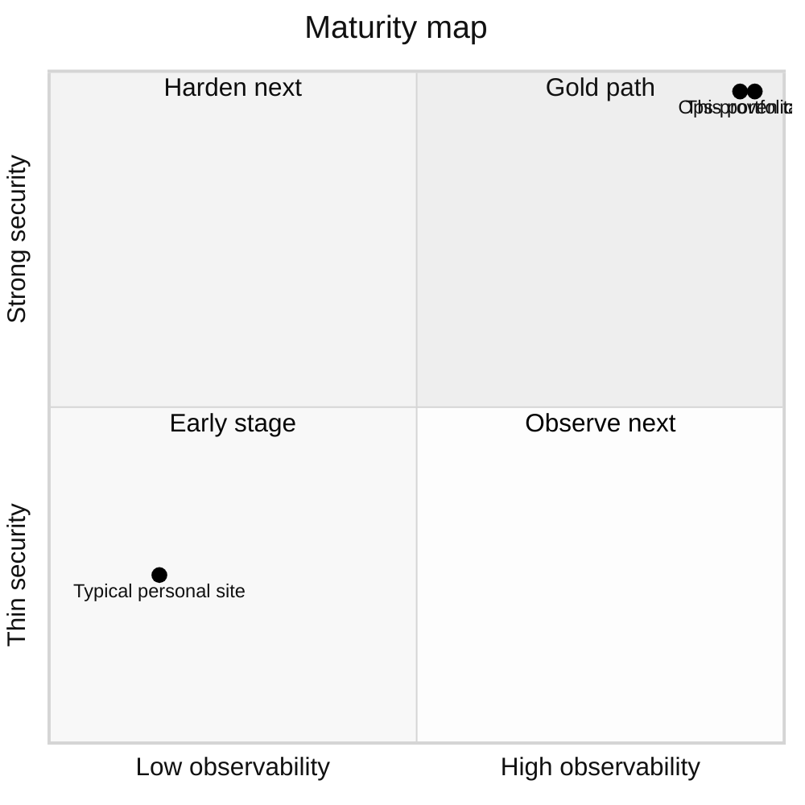

# Portfolio Assessment — Rating, Gaps & Roadmap

Honest maturity review of **mohammedsufyan.com** after gold-path + P0/P1 closure.  
Related: [SECURITY.md](./SECURITY.md) · [SECURITY_CONFIGURATION.md](./SECURITY_CONFIGURATION.md) · [EXTERNAL_TOOLS_AND_COSTS.md](./EXTERNAL_TOOLS_AND_COSTS.md) · [ARCHITECTURE.md](./ARCHITECTURE.md)

---

## Executive verdict

| Goal | Realistic target | Where you are today |
|------|------------------|---------------------|
| Security | Defense-in-depth, no known high-severity gold-path gaps | **~97/100** in code (CMS seed-hides, deep experience rules, Mermaid DOMPurify, Admin-only PII, CSP + Live S2S, CI SAST) |
| Observability | Product telemetry + SRE hooks | **~94/100** (Prometheus `/api/metrics`, RAG/voice/CSP counters, request IDs, JSON logs, Sentry/Slack, `/api/status` snapshot) |
| Product polish | Recruiter-ready + control map | **~94/100** (Portfolio Architecture hub, CMS, dual voice, accents) |
| **Overall** | World-class personal security portfolio | **~96/100** |

**Why not 99?** Remaining points are *production proof*, not missing features:

1. Firebase Console **App Check Enforcement** on for Firestore  
2. Live `SENTRY_DSN` + Slack webhook + Upstash Redis/Vector + Turnstile + `SESSION_SECRET` + Grok secrets in Cloud Run  
3. External uptime vendor green for **30 days** on `/api/uptime`  
4. Optional: enable `CSP_STRICT_STYLES=true` after `/api/csp-report` is quiet (style-src-elem/attr split; default stays compatible so React/Motion cannot blank the page)

Inflating the score to 99 without those would be dishonest — and recruiters who can read rules/logs will notice.

---

## Scorecard (0–100)

| Dimension | Score | Rationale |
|-----------|------:|-----------|
| **Security** | **97** | Prior gold path + CMS seed-hides (no soft-delete body leak), deep experience role rules, Mermaid SVG sanitize, `cms_mutated` audit, CI SAST/Trivy |
| **Observability** | **94** | Prometheus `/api/metrics` (+ optional `METRICS_TOKEN`), chat RAG/LLM/voice/CSP/client-error counters, structured chat/voice logs, `/api/status.observability` |
| **Feature polish** | **94** | Owner CMS hub, Portfolio Architecture, dual voice, accents |
| **Hiring narrative** | **94** | Live control map + gold-path + metrics exposition |
| **Overall** | **96** | Ops checklist below unlocks ~97–98 |

---

## Closed in this pass

- Client **PII creates denied** (`cv_downloads` / `contact_messages` → Admin SDK only)  
- **`portfolio_settings/public`** UX slice vs **`global`** owner policy  
- IP intel **HTTPS-only** (ipwho.is → ipapi.co)  
- CSP **`report-uri`** + **Report-Only** (no `unsafe-inline` scripts; style elem/attr telemetry) for migration  
- Optional **`CSP_STRICT_STYLES`** kill-switch for enforcing `style-src-elem` / `style-src-attr` split  
- Production CSP **`wss://api.x.ai`** for Live S2S + CI **CSP headers smoke**  
- Dual voice: PTT + Live S2S; amber accent hover-only remaps; maintenance banner stacking  
- `/api/uptime` probe for external monitors  
- Case notes on the Security Architecture page  
- **CI split into separate checks:** SemVer, typecheck, unit/coverage, audit, build, CSP, bundle size, Firestore rules lint + emulator tests, Gitleaks, Bandit, Semgrep, CodeQL, Docker, Trivy — [CI.md](./CI.md)

---

## Remaining (ops, not code)

| Item | Action |
|------|--------|
| App Check Enforcement | Firebase Console → App Check → Firestore Enforce |
| Secrets green | Turnstile, SESSION_SECRET, Redis, Vector, Grok, Admin JSON, Sentry, Slack |
| `STRICT_PROD_HARDENING=true` | Health/uptime return 503 if gold path incomplete |
| External uptime | Point Better Stack / UptimeRobot at `https://www.mohammedsufyan.com/api/uptime` |
| Deploy rules + indexes | `firestore.rules` + `firestore.indexes.json` |
| CI/CD | All separate PR checks green + merge-to-`main` auto-deploys Cloud Run (WIF) — see [ARCHITECTURE.md](./ARCHITECTURE.md#cicd) |

---

## Path from 95 → mid-90s

1. Deploy rules; confirm Admin writes appear in Owner Console after a test OTP.  
2. Enable App Check Enforcement.  
3. Set observability secrets; confirm Slack on a test live-chat alert.  
4. Attach an uptime check for 7–30 days.  
5. Confirm Live Call on production after CSP deploy (`wss://api.x.ai`).  

Then you can honestly say **~96–97 production gold path** — still not a magical 99, and that honesty is the engineering signal.
