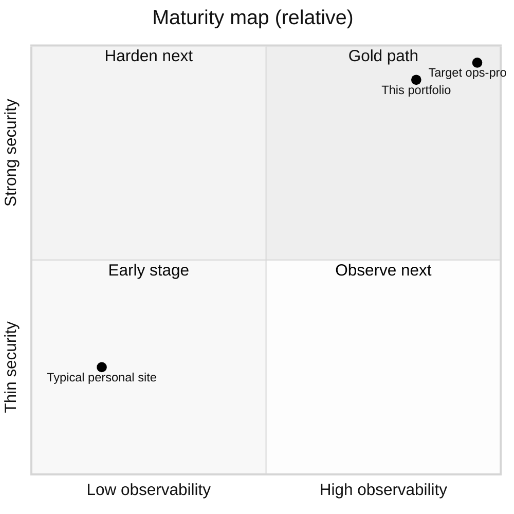

# Portfolio Assessment — Rating, Gaps & Roadmap

Honest maturity review of **mohammedsufyan.com** after gold-path security + observability hardening.  
Related: [SECURITY.md](../SECURITY.md) · [SECURITY_CONFIGURATION.md](./SECURITY_CONFIGURATION.md) · [EXTERNAL_TOOLS_AND_COSTS.md](./EXTERNAL_TOOLS_AND_COSTS.md) · [ARCHITECTURE.md](./ARCHITECTURE.md)

---

## Executive verdict

This is a **top-tier** personal portfolio for a security / platform engineer: Express hardening, Firestore rules, OTP lead capture, owner governance, chat, alerts, Redis-shared quotas/OTP/sessions, structured observability hooks, and a public Security Architecture map.

**Nothing is literally “100% secure” or “99% with a guarantee.”** Those claims are marketing. What this codebase can honestly claim:

| Goal | Realistic target | Where you are today |
|------|------------------|---------------------|
| Security | Defense-in-depth with **no known high-severity gaps in the gold deploy path** | **~92/100** in code when env gold-path is green; **~80–92** depending on prod secrets |
| Observability | Owner product telemetry **plus** production SRE signals | **~82/100** in code (request IDs, JSON logs, metrics, Sentry/Slack hooks, status/health); still needs live DSN/webhook + uptime vendor |
| Product polish | Recruiter-ready narrative + complete feature set | **~90/100** |
| **Overall** | World-class personal security portfolio | **~91/100** |

**Why not 99?** A credible 99 requires continuous production proof: external uptime history, error budgets met for weeks, App Check enforced with attested traffic, WAF telemetry wired to a SIEM, pen-test / bug-bounty findings closed, and budget alerts live. That is **ops maturity**, not more React. With this push the *code* gold path is essentially complete; turn every `/api/status` boolean green in production and you sit in the low-to-mid 90s.

---

## Scorecard (0–100)

| Dimension | Score | One-line rationale |
|-----------|------:|--------------------|
| **Security defense-in-depth** | **92** | Edge + app + data controls; Redis OTP/sessions/quotas; Admin-bound replies; fail-closed policy; security.txt; chat bot UA filter. |
| **Observability / monitoring** | **82** | Request IDs, structured logs, metrics, client-error intake, Sentry/Slack hooks, public `/api/status`, owner observability API. |
| **Feature polish** | **90** | Owner console, chat, CV studio, governance, Security Architecture page, feature switches. |
| **Hiring narrative / credibility** | **90** | Live control map + gold-path health checklist is a strong interview artifact. |
| **Overall product** | **91** | Remaining points are production verification (uptime vendor, App Check enforce, deny public PII creates). |

---

## What shipped in this hardening pass

- `X-Request-Id` + structured JSON access logs for API traffic  
- Optional **Sentry** (`SENTRY_DSN`) + **Slack** (`SLACK_ALERT_WEBHOOK_URL`) for urgent/warning alerts  
- `/api/status` public booleans + `/api/health` gold-path checklist (`STRICT_PROD_HARDENING`)  
- `/.well-known/security.txt` + `#security` Security Architecture modal  
- Redis-backed **OTP challenges** + **chat session** write-through  
- Chat routes included in sensitive bot-UA filter  
- Client ErrorBoundary → `/api/telemetry/client-error`  
- Owner `/api/owner/observability` metrics snapshot  

---

## Security — remaining gaps (honest)

| P | Gap | Fix |
|---|-----|-----|
| P0 | **App Check not enforced** in Firestore rules | Enable reCAPTCHA Enterprise → `request.app != null` |
| P0 | **Public creates** on PII collections until Admin path verified | Confirm Admin writes → `allow create: if false` |
| P0 | Turnstile / SESSION_SECRET / Redis unset in a deploy | Set secrets; enable `STRICT_PROD_HARDENING=true` |
| P1 | CSP still allows `'unsafe-inline'` | Nonces/hashes + CSP reporting |
| P1 | Public read of full `portfolio_settings/global` | Split public UX flags vs private policy |
| P2 | IP intel over HTTP | Prefer HTTPS intel provider |

---

## Observability — remaining gaps

| Gap | Recommendation |
|-----|----------------|
| External **uptime** synthetics | Better Stack / UptimeRobot / Cloud Monitoring on `/api/health` + homepage |
| Live **Sentry + Slack** in prod | Set `SENTRY_DSN` + `SLACK_ALERT_WEBHOOK_URL` |
| Cloud **Trace / metrics dashboards** | OpenTelemetry exporter or GCP Monitoring policies |
| Cloudflare **Security Events** | Logpush or dashboard review cadence |
| Billing budgets | GCP + Resend usage alerts |

---

## Product recommendations

1. Keep the Security Architecture page linked from Hero as a hiring CTA (Footer + `#security` already wired).  
2. Publish 2–3 short case studies (OTP design, fail-closed Redis, Firestore rules).  
3. After Admin writes are proven for 7 days, deny client PII creates.  
4. Enforce App Check.  
5. Add an external uptime check and leave it green for 30 days — that is how you honestly move from **91 → mid-90s**.

---

## Definition of “production-ready gold path”

- [ ] Cloudflare proxy + Bot Fight + Turnstile live  
- [ ] `TRUST_PROXY=1`, `SESSION_SECRET` set, Turnstile keys set  
- [ ] Upstash Redis configured; `/api/health` → `distributedStore: "redis"`  
- [ ] Admin SDK writes on; client creates denied for PII collections  
- [ ] App Check enforced on Firestore  
- [ ] `SENTRY_DSN` + `SLACK_ALERT_WEBHOOK_URL` set  
- [ ] External uptime check green 7+ days  
- [ ] `STRICT_PROD_HARDENING=true` and `/api/health` stays 200  

When that checklist is green, you can say: **production gold-path secured and monitored (~94–96)**. Still not a magical 99 — and that honesty is part of the engineering signal.
