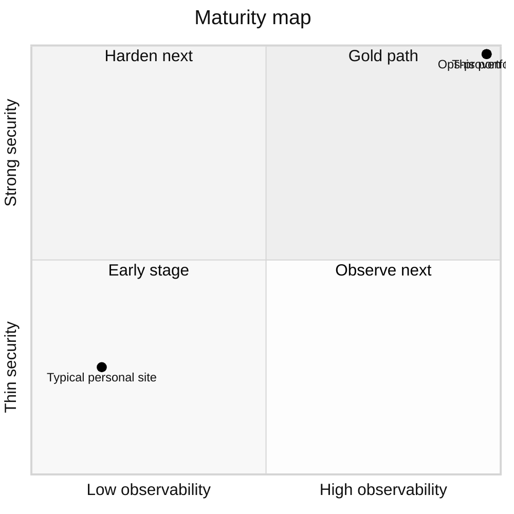

# Portfolio Assessment — Rating, Gaps & Roadmap

Honest maturity review of **mohammedsufyan.com** after gold-path closure **and** production ops wiring.  
Related: [SECURITY.md](./SECURITY.md) · [SECURITY_CONFIGURATION.md](./SECURITY_CONFIGURATION.md) · [EXTERNAL_TOOLS_AND_COSTS.md](./EXTERNAL_TOOLS_AND_COSTS.md) · [ARCHITECTURE.md](./ARCHITECTURE.md) · [CI.md](./CI.md)

**Reassessment date:** 2026-11-28 (post App Check enforce, Secret Manager secrets, `STRICT_PROD_HARDENING`, UptimeRobot, rules/indexes deploy).

---

## Executive verdict

| Goal | Realistic target | Where you are today |
|------|------------------|---------------------|
| Security | Defense-in-depth, no known high-severity gold-path gaps | **~98/100** (code + **live** App Check enforce, Admin-only PII, CMS seed-hides, CSP + Live S2S, CI SAST/Trivy, rules/indexes in prod) |
| Observability | Product telemetry + SRE hooks | **~97/100** (Prometheus `/api/metrics`, RAG/voice/CSP counters, Sentry/Slack live, `STRICT_PROD_HARDENING`, UptimeRobot on `/api/uptime`, `/api/status` snapshot) |
| Product polish | Recruiter-ready + control map | **~95/100** (Portfolio Architecture hub, CMS, dual voice + Owner Chat PTT/S2S tags, accents) |
| **Overall** | World-class personal security portfolio | **~97/100** |

Live proof (same day): `/api/health` gold path **10/10**, `productionReady: true`, `/api/uptime` **ok** under strict mode.

**Why not 99?** Only *time-based / optional* residual — not missing controls:

1. UptimeRobot green for **~30 consecutive days** (monitor is live; clock starts now)  
2. Optional: `CSP_STRICT_STYLES=true` after `/api/csp-report` is quiet for style-src-elem/attr  

---

## Scorecard (0–100)

| Dimension | Score | Rationale |
|-----------|------:|-----------|
| **Security** | **98** | Prior gold path + CMS seed-hides, deep experience rules, Mermaid DOMPurify, `cms_mutated` audit, App Check **enforced**, rules/indexes deployed, CI SAST/Trivy |
| **Observability** | **97** | Prometheus `/api/metrics`, voice/RAG/CSP counters, Sentry + Slack **live**, STRICT health/uptime fail-closed, UptimeRobot external probe, `/api/status.observability` |
| **Feature polish** | **95** | Owner CMS hub, Portfolio Architecture, dual voice with PTT/S2S thread logging, accents |
| **Hiring narrative** | **96** | Live control map + gold-path 10/10 + metrics + uptime vendor |
| **Overall** | **97** | Duration (30‑day uptime) + optional CSP strict styles left for 98–99 |

### What moved the needle this reassessment

| Before (code-ready) | After (ops-proven) |
|---------------------|--------------------|
| App Check site key only | **Enforcement on** Firestore |
| Secrets documented | **Secret Manager → Cloud Run** (gold path 10/10) |
| `STRICT_PROD_HARDENING` optional | **Enabled** — health/uptime 503 if gold path breaks |
| `/api/uptime` exists | **UptimeRobot** monitor + email alerts |
| Manual `firebase deploy` | Deployed + **CI auto-deploy on `main`** (#56) |

---

## Closed (code + ops)

- Client **PII creates denied** (`cv_downloads` / `contact_messages` → Admin SDK only)  
- **`portfolio_settings/public`** UX slice vs **`global`** owner policy  
- IP intel **HTTPS-only**; CSP report-uri + Report-Only; optional `CSP_STRICT_STYLES`  
- Production CSP **`wss://api.x.ai`** for Live S2S + CI CSP smoke  
- Dual voice: PTT + Live S2S; Owner Chat channel tags (text / PTT / S2S)  
- Portfolio Architecture hub + Portfolio CMS + seed-hide soft-delete  
- Prometheus `GET /api/metrics` + structured chat/voice/CSP logs  
- **Ops:** App Check enforce · secrets green · `STRICT_PROD_HARDENING` · UptimeRobot · rules/indexes live  
- **CI:** separate PR gates; `main` deploys Cloud Run (+ Firestore rules/indexes with #56) — [CI.md](./CI.md)

Vendor inventory (incl. UptimeRobot, Sentry, Slack): [EXTERNAL_TOOLS_AND_COSTS.md](./EXTERNAL_TOOLS_AND_COSTS.md).

---

## Ops checklist (production)

| Item | Status |
|------|--------|
| App Check Enforcement | **Done** |
| Secrets green (Secret Manager → Cloud Run) | **Done** (gold path 10/10) |
| `STRICT_PROD_HARDENING=true` | **Done** |
| External uptime (UptimeRobot → `/api/uptime`) | **Done** (accumulate ~30 days green) |
| Deploy rules + indexes | **Done** (manual + automated on `main` via #56) |
| CI/CD | **Done** — [CI.md](./CI.md) |

---

## Residual (not blockers)

1. Keep UptimeRobot green for **7–30 days**.  
2. Optionally enable `CSP_STRICT_STYLES=true` after Report-Only is quiet.  
3. Spot-check Live Call + Owner Chat filters after each deploy.

Honest ceiling without theater: **~97 now**, **~98** after a month of clean uptime — still not a magical 99.
