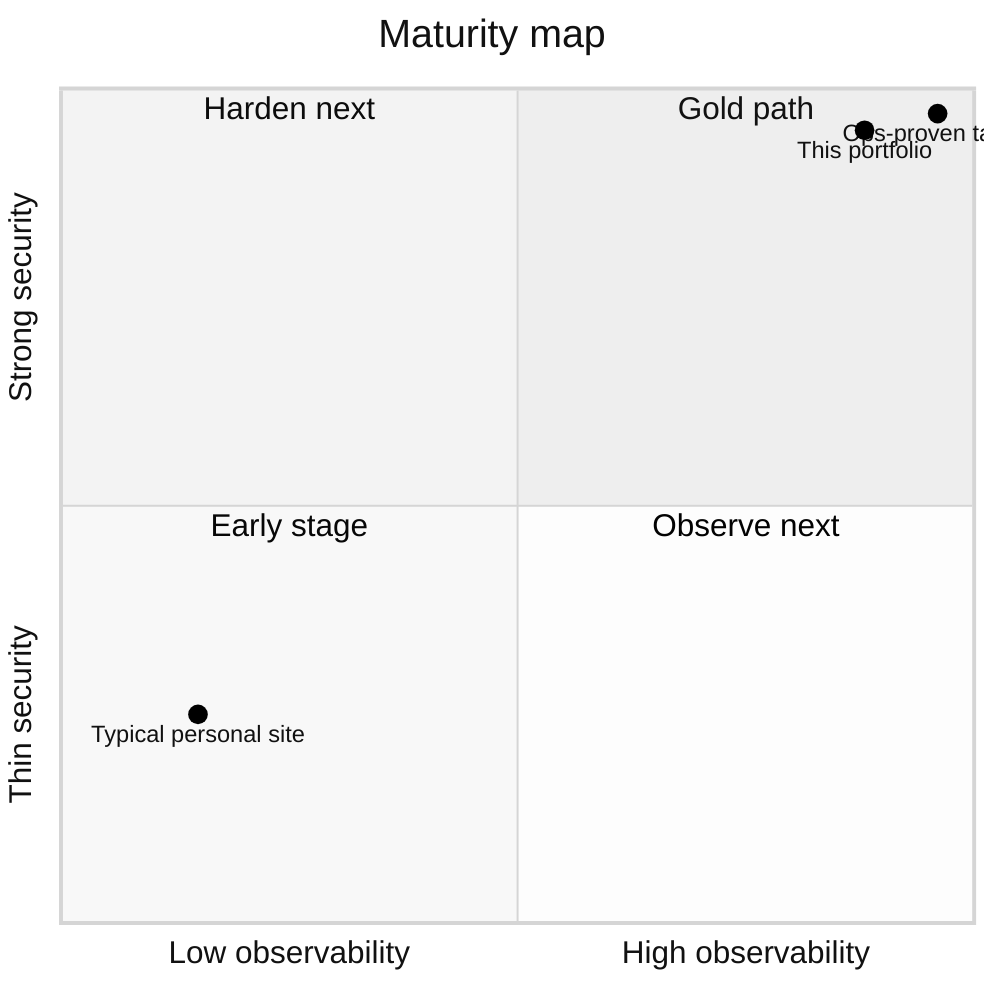

# Portfolio Assessment — Rating, Gaps & Roadmap

Honest maturity review of **mohammedsufyan.com** after gold-path + P0/P1 closure.  
Related: [SECURITY.md](../SECURITY.md) · [SECURITY_CONFIGURATION.md](./SECURITY_CONFIGURATION.md) · [EXTERNAL_TOOLS_AND_COSTS.md](./EXTERNAL_TOOLS_AND_COSTS.md) · [ARCHITECTURE.md](./ARCHITECTURE.md)

---

## Executive verdict

| Goal | Realistic target | Where you are today |
|------|------------------|---------------------|
| Security | Defense-in-depth, no known high-severity gold-path gaps | **~95/100** in code (Admin-only PII, split settings, HTTPS IP intel, CSP reporting) |
| Observability | Product telemetry + SRE hooks | **~88/100** (request IDs, JSON logs, metrics, Sentry/Slack, `/api/uptime`, CSP reports) |
| Product polish | Recruiter-ready + control map | **~92/100** |
| **Overall** | World-class personal security portfolio | **~94/100** |

**Why not 99?** Remaining points are *production proof*, not missing features:

1. Firebase Console **App Check Enforcement** on for Firestore  
2. Live `SENTRY_DSN` + Slack webhook + Upstash + Turnstile + `SESSION_SECRET` in Cloud Run  
3. External uptime vendor green for **30 days** on `/api/uptime`  
4. Optional: CSP nonce migration (report-only is already collecting violations)

Inflating the score to 99 without those would be dishonest — and recruiters who can read rules/logs will notice.

---

## Scorecard (0–100)

| Dimension | Score | Rationale |
|-----------|------:|-----------|
| **Security** | **95** | Deny-by-default rules; Admin-only PII creates; public/private settings split; Redis OTP/sessions/quotas; fail-closed policy; HTTPS IP intel; CSP + report-only + report-uri |
| **Observability** | **88** | Structured logs, request IDs, metrics, client errors, CSP reports, `/api/status` + `/api/uptime`, Sentry/Slack hooks |
| **Feature polish** | **92** | Owner console, chat, Security Architecture + case notes, feature switches |
| **Hiring narrative** | **93** | Live control map + gold-path health is interview-grade |
| **Overall** | **94** | Ops checklist below unlocks ~96–97 |

---

## Closed in this pass

- Client **PII creates denied** (`cv_downloads` / `contact_messages` → Admin SDK only)  
- **`portfolio_settings/public`** UX slice vs **`global`** owner policy  
- IP intel **HTTPS-only** (ipwho.is → ipapi.co)  
- CSP **`report-uri`** + **Report-Only** (no `unsafe-inline` scripts) for migration telemetry  
- `/api/uptime` probe for external monitors  
- Case notes on the Security Architecture page  

---

## Remaining (ops, not code)

| Item | Action |
|------|--------|
| App Check Enforcement | Firebase Console → App Check → Firestore Enforce |
| Secrets green | Turnstile, SESSION_SECRET, Redis, Admin JSON, Sentry, Slack |
| `STRICT_PROD_HARDENING=true` | Health/uptime return 503 if gold path incomplete |
| External uptime | Point Better Stack / UptimeRobot at `https://www.mohammedsufyan.com/api/uptime` |
| Deploy rules + indexes | `firestore.rules` + `firestore.indexes.json` |

---

## Path from 94 → mid-90s

1. Deploy rules; confirm Admin writes appear in Owner Console after a test OTP.  
2. Enable App Check Enforcement.  
3. Set observability secrets; confirm Slack on a test live-chat alert.  
4. Attach an uptime check for 7–30 days.  

Then you can honestly say **~96–97 production gold path** — still not a magical 99, and that honesty is the engineering signal.
