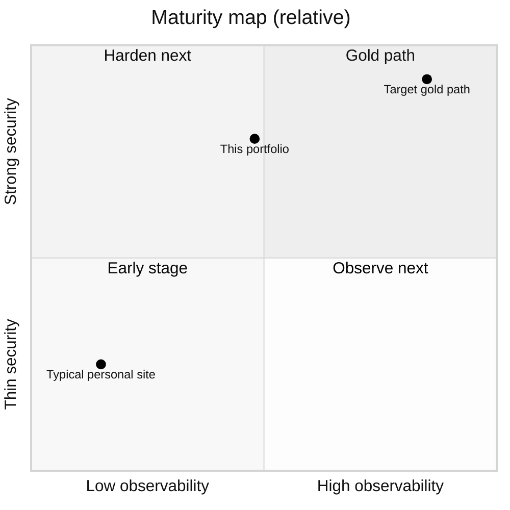
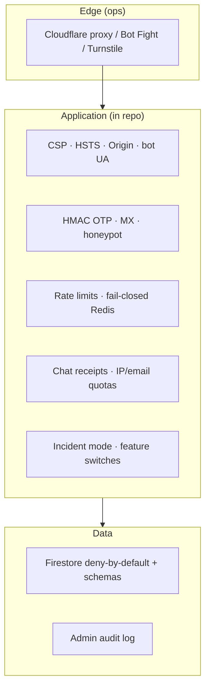
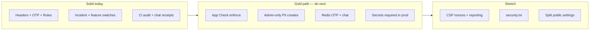
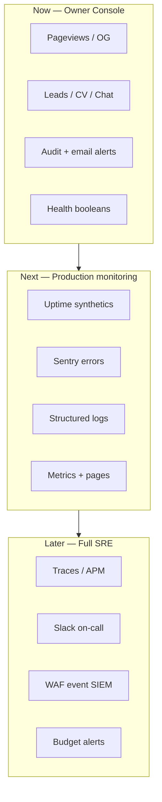
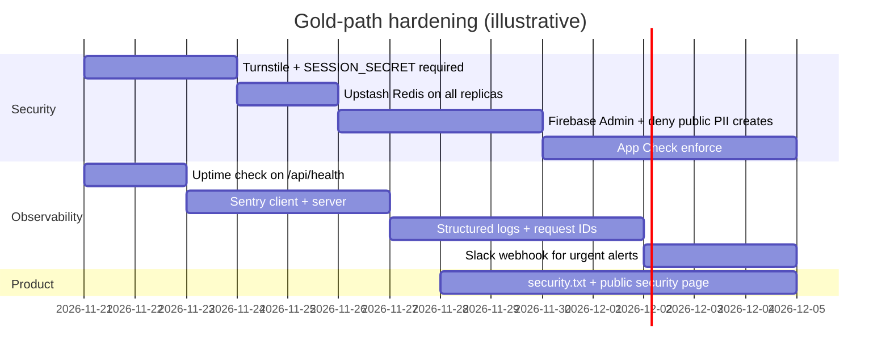

# Portfolio Assessment — Rating, Gaps & Roadmap

Honest maturity review of **mohammedsufyan.com** (codebase as of the owner-console feature branch).  
Related: [SECURITY.md](../SECURITY.md) · [SECURITY_CONFIGURATION.md](./SECURITY_CONFIGURATION.md) · [EXTERNAL_TOOLS_AND_COSTS.md](./EXTERNAL_TOOLS_AND_COSTS.md) · [ARCHITECTURE.md](./ARCHITECTURE.md)

---

## Executive verdict

This is an **unusually strong** personal portfolio for a security / platform engineer: real Express hardening, Firestore rules, OTP lead capture, owner governance, chat, alerts, and CI — not just a static site with marketing copy.

**Nothing is “100% secure” or “100% monitored.”** Those phrases are marketing, not engineering. What you *can* aim for is:

| Goal | Realistic target | Where you are today |
|------|------------------|---------------------|
| Security | Defense-in-depth with **no known high-severity gaps in the gold deploy path** | **~78/100** in code; **~65–85/100** depending on whether Turnstile, Redis, Admin SDK, App Check, and Cloudflare are actually enabled in prod |
| Observability | Owner product telemetry **plus** production SRE signals (errors, uptime, traces) | **~48/100** — excellent owner console; thin ops/APM layer |
| Product polish | Recruiter-ready narrative + complete feature set | **~84/100** |
| **Overall** | World-class personal security portfolio | **~76/100** |

---

## Scorecard (0–100)

| Dimension | Score | One-line rationale |
|-----------|------:|--------------------|
| **Security defense-in-depth** | **78** | Strong layered controls in repo; several high-value pieces are still optional or single-instance. |
| **Observability / monitoring** | **48** | Rich owner KPIs + email alerts; no APM, error tracking, synthetics, or on-call webhooks. |
| **Feature polish** | **84** | Owner console, chat, CV studio, governance, docs, and feature switches are well beyond typical portfolios. |
| **Hiring narrative / credibility** | **82** | Real working controls make a compelling story — package them more visibly for recruiters. |
| **Overall product** | **76** | Ceiling is ops hardening + observability, not missing page sections. |

---

## What you already do well (security)

**Always-on (when deployed):** security headers, origin/`Sec-Fetch-Site` checks, honeypot, OTP flows, allow/block rules, incident mode, chat receipt headers, visitor feature switches, Firestore schema rules, CI `npm audit`, no prod source maps.

**Gold-path env (must be on in production):** Turnstile secrets, explicit `SESSION_SECRET`, Upstash Redis, Firebase Admin SDK, Cloudflare proxy + `TRUST_PROXY=1`, verified Resend domain.

---

## Security — what is *not* “100%” (honest gaps)

Priority order for closing the gold path:

| P | Gap | Risk | Fix |
|---|-----|------|-----|
| P0 | **App Check not enforced** in `firestore.rules` | Unattested clients can still hit public create paths | Enforce `request.app != null`; enable reCAPTCHA Enterprise |
| P0 | **Public creates** on `cv_downloads` / `contact_messages` until Admin SDK is live | Spam / denial-of-wallet | Confirm Admin writes → set `allow create: if false` for clients |
| P0 | **OTP / chat / digest in process memory** | Broken or bypassable under multi-replica Cloud Run | Redis (or sticky sessions) for OTP + chat sessions |
| P0 | **Turnstile / SESSION_SECRET unset** | No bot challenge; HMAC mismatch across instances | Require secrets in Cloud Run; fail health if missing in prod |
| P1 | **Rate limits without Redis** | Per-instance bypass | Upstash on every replica (already fail-closed when configured) |
| P1 | **Public read of `portfolio_settings/global`** | Recon of caps / incident posture | Split public UX flags vs private policy doc |
| P1 | **CSP still allows `'unsafe-inline'`** | XSS blast radius | Tighten with nonces/hashes; add CSP reporting |
| P1 | **Missing Origin/Referer allowed** | Soft CSRF for non-browser clients | Pair with Turnstile + RL (already); optionally require Fetch Metadata |
| P2 | Chat POSTs not in “sensitive UA” filter | Scripted chat spam | Extend `isSensitivePost` to `/api/chat/*` |
| P2 | No `/.well-known/security.txt` | Disclosure hygiene | Add security.txt + disclosure page |
| P2 | IP intel over HTTP (`ip-api.com`) | Integrity of risk signals | Prefer HTTPS provider or Cloud intel |
| P2 | Edge WAF only in docs | Origin scraping if `*.run.app` leaks | Cloudflare proxy only; optional Cloud Armor |

**Important:** Public SPA content (resume text, skills) can never be DRM’d in the browser. Your CV OTP gate is **lead verification**, not content protection — and that is the correct model.

---

## Observability — what you monitor today vs 100%

### Today (owner / product telemetry) — strong

| Signal | Where |
|--------|--------|
| Pageviews / OG shares | `/api/telemetry/event` + Owner Profile |
| Inquiries + CRM + triage | Firestore + Owner Console |
| CV export risk / VPN | CV logs + alert mail |
| Chat KPIs + live sessions | Chat cache + `#owner/chat` |
| Admin audit trail | `admin_audit_logs` |
| Ops health strip | `/api/health` (mail, Turnstile, Redis, Admin writes, incident) |
| Email alert router | Urgent / warning / digest |
| CI | Lint, tests, audit, build |
| Container health | Dockerfile → `/api/health` |

### Missing (production SRE) — why score is ~48

| Gap | Why it matters | Recommendation |
|-----|----------------|----------------|
| **Error tracking** | Silent 500s / React crashes | Sentry (or Cloud Error Reporting) for client + server |
| **Uptime / synthetics** | Know the site is down before recruiters do | UptimeRobot / Better Stack / Cloud Monitoring uptime check on `/api/health` + homepage |
| **Structured logs + request IDs** | Can’t correlate an OTP failure to a request | JSON logs (`severity`, `requestId`, `route`) → Cloud Logging |
| **APM / traces** | Latency of OTP / Resend / Firestore | OpenTelemetry → Cloud Trace (or similar) |
| **Metrics + dashboards** | Rate-limit denials, Redis fail-closed, 429s | Cloud Monitoring metrics + alert policies |
| **On-call beyond email** | Missed digests | Slack/Discord webhook or PagerDuty for urgent class |
| **Security event feed** | WAF / bot fights invisible in-app | Cloudflare Security Events + optional logpush |
| **Budget alerts** | Resend / Cursor / GCP surprise bills | Billing budgets on GCP + Resend usage alerts |

**“Monitor each and every step”** for this product means: every lead, OTP, CV export, chat session, owner action, and alert — **you largely already do that in the Owner Console.**  
What you do *not* yet monitor is every **infrastructure** step (process crash, cold start spike, dependency outage, WAF challenge storm).

---

## Product / feature recommendations (what’s missing)

### High impact for hiring signal

1. **Public Security Architecture page** — interactive control map (threat → control) without secrets; link from Hero.
2. **Live status badge** — “OTP · Turnstile · Redis · Admin writes” booleans only (from a public `/api/status` subset).
3. **Case-study write-ups** — 3 short posts: OTP design, Firestore rules pitfalls, rate-limit fail-closed.
4. **`security.txt` + disclosure** — professionalism signal.

### Medium impact

5. Redis-backed OTP + live chat (reliability story).
6. Split public vs private portfolio settings.
7. SBOM / provenance badge next to CI.
8. Optional public changelog fed from published announcements.

### Nice to have

9. i18n / locale — only if you target non-US hiring.
10. Blog / RSS — if you want content SEO.
11. Accessibility audit pass (axe) published as a score.

---

## Recommended 30-day hardening plan

### Definition of “production-ready gold path”

- [ ] Cloudflare proxy + Bot Fight + Turnstile live  
- [ ] `TRUST_PROXY=1`, `SESSION_SECRET` set, Turnstile keys set  
- [ ] Upstash Redis configured; `/api/health` → `distributedStore: "redis"`  
- [ ] Admin SDK writes on; client creates denied for PII collections  
- [ ] App Check enforced on Firestore  
- [ ] External uptime check green 7 days  
- [ ] Error tracker receiving events (with sample rate)  
- [ ] Urgent alerts → email **and** Slack/webhook  

When that checklist is green, you can honestly say: **“production gold-path secured and monitored”** — still not “100%,” but **credible and defensible**.

---

## Rating summary for you

| Question | Answer |
|----------|--------|
| Is this a strong portfolio for a security engineer? | **Yes — top tier for a personal site.** |
| Is it 100% secure? | **No — and no public site is.** Gold path ≈ high 80s when env hardening is complete. |
| Is every step monitored? | **Business/lead steps: largely yes. Infrastructure/SRE steps: not yet.** |
| Biggest ROI next step? | **(1) Admin SDK + deny public PII creates (2) Redis (3) Uptime + Sentry (4) App Check enforce.** |
| What to add for wow factor? | **Public security architecture page + status badges + 2–3 case studies.** |
