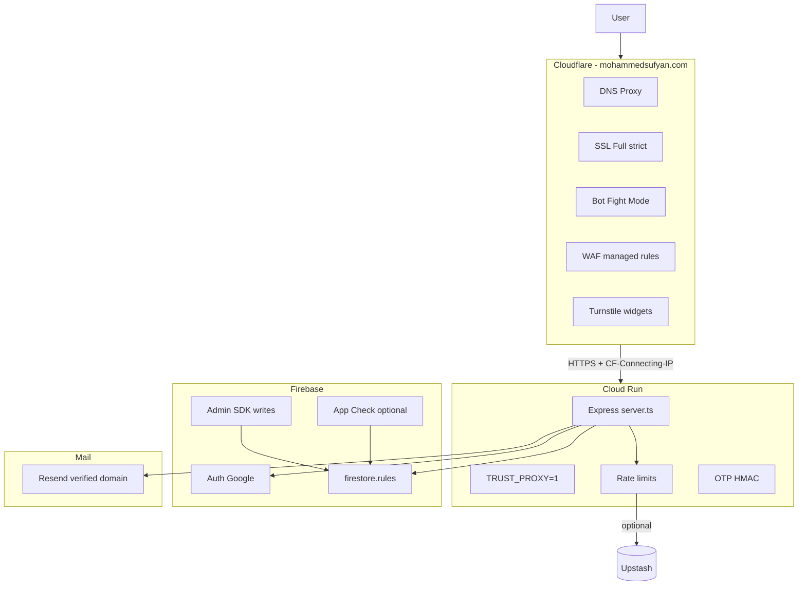
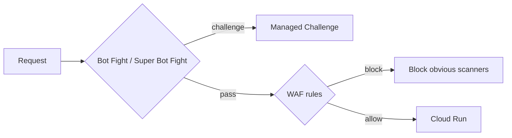
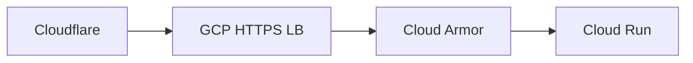
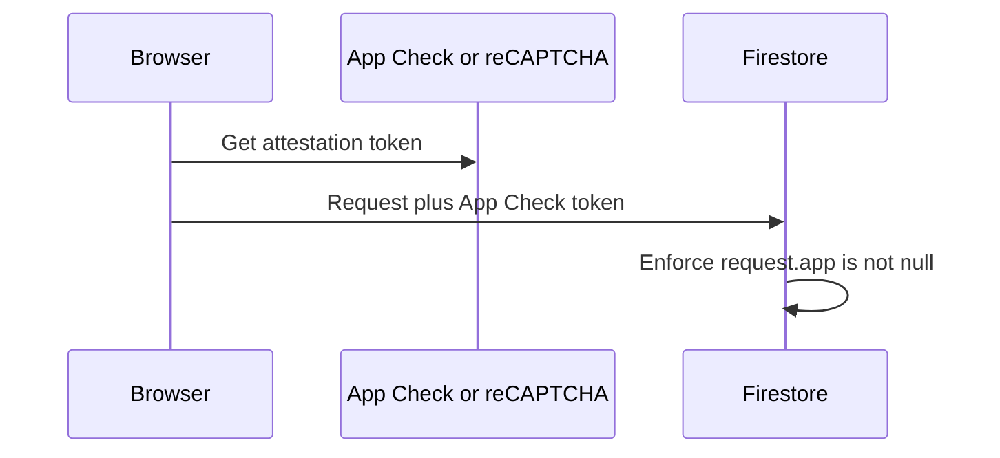
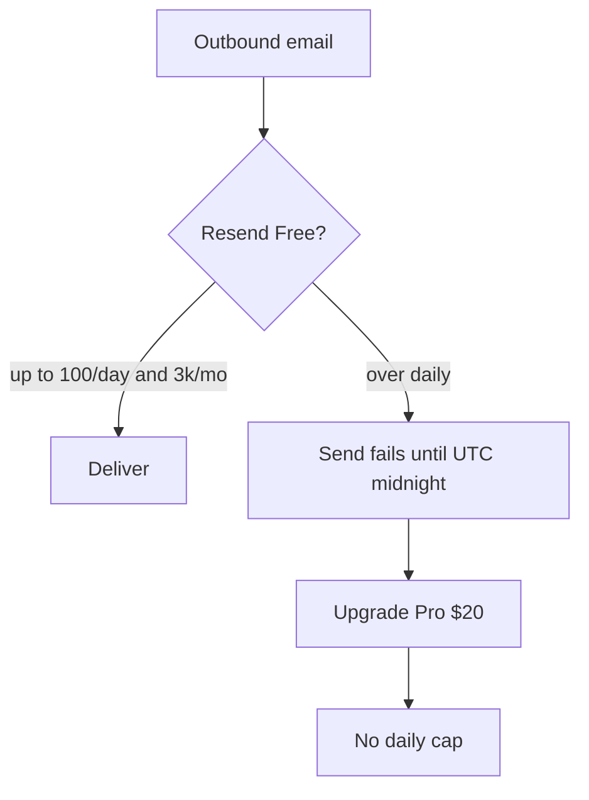
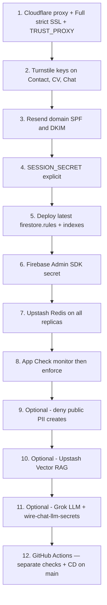

# Security Configuration Guide

Recommended security settings for the live portfolio stack:

**Cloudflare (domain) → Google Cloud Run (app) → Firebase (auth/data) → Resend/SMTP (mail)**

Related: [EXTERNAL_TOOLS_AND_COSTS.md](./EXTERNAL_TOOLS_AND_COSTS.md) · [ARCHITECTURE.md](./ARCHITECTURE.md) · [SECURITY.md](./SECURITY.md)

---

## Target architecture (hardened)


---

## 1. Cloudflare (domain already here)

### Done / do now

| Setting | Recommended value | Why |
|---------|-------------------|-----|
| DNS records | Proxied (**orange cloud**) for web hostname | Hides Cloud Run origin IP; enables WAF/bots |
| SSL/TLS mode | **Full (strict)** | End-to-end TLS with valid origin cert |
| Always Use HTTPS | **On** | Force TLS |
| Minimum TLS | **1.2** | Drop legacy TLS |
| Bot Fight Mode | **On** (Free) | Challenge simple bots / hosting ASNs |
| Block AI Bots | **On** (when offered) | Edge deny for known AI crawlers (pairs with app UA middleware) |
| Security Level | **Medium** (raise to High under attack) | Challenge suspicious clients |
| Turnstile | Create **Managed** widget for `www` + apex | Contact, CV gate, live chat |
| `TRUST_PROXY` on Cloud Run | **`1`** (or hop count to CF) | Correct client IP for rate limits |
| Verify edge | `GET /api/status` → `controls.cloudflareEdge: true` | Confirms CF-Ray / CF-Connecting-IP reach Express |

### Recommended WAF (Free → Pro)


**Free plan**

1. **Security → Settings → Bot traffic → Bot Fight Mode → On**
2. Enable **Block AI Bots** if offered (pairs with our `robots.txt` + UA middleware).
3. Review **Security → Events** weekly after enabling.

**Pro plan (~$20/mo) — when Free is not enough**

1. Disable Bot Fight Mode, enable **Super Bot Fight Mode**.
2. Definitely automated → Managed Challenge; Likely automated → Challenge; Verified bots → Allow.
3. Enable **Cloudflare Managed** WAF ruleset.
4. Optional custom rule: challenge `POST` to `/api/contact*` and `/api/chat/live/start` when bot score is low (Enterprise bot score) or on empty `Accept-Language`.

### Turnstile widget setup

1. Cloudflare Dashboard → Turnstile → **Add widget**
2. Domains: `mohammedsufyan.com`, `www.mohammedsufyan.com`
3. Mode: **Managed**
4. Copy **Site Key** → `VITE_TURNSTILE_SITE_KEY` (build-time) and/or runtime access-config
5. Copy **Secret Key** → Cloud Run secret `TURNSTILE_SECRET_KEY`
6. Redeploy / rebuild so the client bundle or `/api/access-config` exposes the site key

### DNS tip

Keep **only** Cloudflare-facing hostnames orange-clouded. Do not publish the raw `*.run.app` URL in public marketing links (reduces origin bypass). Optionally restrict Cloud Run ingress to Cloudflare IPs via load balancer / Cloud Armor if you outgrow simple proxy.

---

## 2. Google Cloud Run (deploy target)

### Recommended service settings

| Setting | Value | Why |
|---------|-------|-----|
| Ingress | All / load balancer as designed | Behind Cloudflare |
| Authentication | **Allow unauthenticated** (public site) | Portfolio is public |
| Min instances | **0** | Cost; accept cold start |
| Max instances | **3–10** for personal traffic | Cap runaway scale |
| CPU / memory | **1 vCPU / 512Mi–1Gi** | Enough for Express + OTP |
| Concurrency | 40–80 | Match Node event loop |
| Secrets | Mount via Secret Manager | Never bake keys into image |
| Env | See table below | |

### Required / recommended env on Cloud Run

```bash
NODE_ENV=production
APP_URL=https://www.mohammedsufyan.com
TRUST_PROXY=1
SESSION_SECRET=<long random 32+ bytes>
CONTACT_TO_EMAIL=sufyan.net@gmail.com

# Mail (pick one primary)
RESEND_API_KEY=re_...
RESEND_FROM_EMAIL="Portfolio <noreply@mohammedsufyan.com>"

# Bot challenge
TURNSTILE_SECRET_KEY=0x...
VITE_TURNSTILE_SITE_KEY=0x...   # if not only from access-config

# Shared limits (multi-instance)
UPSTASH_REDIS_REST_URL=https://....upstash.io
UPSTASH_REDIS_REST_TOKEN=...

# Server PII writes + reply binding
FIREBASE_SERVICE_ACCOUNT_JSON='{"type":"service_account",...}'

# Optional portfolio chat RAG + LLM (Secret Manager → Cloud Run)
# UPSTASH_VECTOR_REST_URL=https://....upstash.io
# UPSTASH_VECTOR_REST_TOKEN=...
# GROK_API_KEY=xai-...
# GROK_API_BASE_URL=https://api.x.ai/v1
# CHAT_LLM_TIMEOUT_MS=12000
# Script: ./scripts/wire-chat-llm-secrets.sh

# Observability (gold path)
# SENTRY_DSN=https://<key>@oXXXX.ingest.sentry.io/<project>
# SLACK_ALERT_WEBHOOK_URL=https://hooks.slack.com/services/...
# STRICT_PROD_HARDENING=true   # /api/health → 503 if gold-path secrets missing in production
# METRICS_TOKEN=...            # optional bearer/query gate for GET /api/metrics

ALLOW_FORMSUBMIT_FALLBACK=false
FORCE_CV_OTP=false   # or true for always-on CV OTP
# CSP_STRICT_STYLES=false  # set true only after /api/csp-report is quiet for style-src-elem/attr
```

Public readiness (no secrets): `GET /api/status` (includes `controls`, `botProtection`, `goldPathScore`, `observability` snapshot) and `GET /api/health` (includes `goldPath` checklist). Prometheus counters: `GET /api/metrics` (gate with `METRICS_TOKEN` when public). Disclosure: `/.well-known/security.txt` and `#architecture` / `#security` Portfolio Architecture map.

### Cloud Armor (optional if not using Cloudflare WAF)

If traffic hits a GCP HTTPS LB instead of (or in addition to) Cloudflare:

1. Attach a **Cloud Armor** policy to the backend.
2. Enable preconfigured WAF rules + adaptive protection.
3. Still set `TRUST_PROXY` so Express sees `X-Forwarded-For`.



---

## 3. Firebase Auth & Firestore

### Auth

| Setting | Recommendation |
|---------|----------------|
| Sign-in providers | **Google** only (owner console) |
| Authorized domains | `localhost`, `mohammedsufyan.com`, `www.mohammedsufyan.com`, Cloud Run host if needed |
| Owner gate | Email allowlist in rules + server (`sufyan.net@gmail.com`) |
| Delegates | `admins/{uid}` docs managed by primary owner |

### Firestore rules & indexes

| Action | Status |
|--------|--------|
| Deploy `firestore.rules` | Auto on `main` CI (WIF + `roles/firebaserules.admin` on deploy SA) |
| Deploy `firestore.indexes.json` | Auto on `main` CI (WIF + `roles/datastore.indexAdmin`) |
| Default deny | Already in rules |
| Public list announcements | Only `status == 'published'` |
| Portfolio CMS | Public get/list of non-deleted docs; admin writes; seed hides for soft-delete |
| Admin audit | Includes `cms_mutated` for CMS upserts/deletes |
| PII collections | Owner/admin read; prefer Admin SDK creates |

### App Check (recommended)


1. Firebase Console → **App Check** → register web app with **reCAPTCHA Enterprise**.
2. Set `VITE_RECAPTCHA_SITE_KEY` or `firebase-applet-config.json` → `recaptchaSiteKey`.
3. Watch metrics in monitor mode → then **Enforce** for Firestore.
4. After Admin SDK writes are proven, set `cv_downloads` / `contact_messages` **create** to `if false` for clients.

### Admin SDK (recommended)

1. Create a service account with Firestore access.
2. Store JSON in Secret Manager → `FIREBASE_SERVICE_ACCOUNT_JSON`.
3. Confirm `/api/health` → `serverTelemetryWrites: true`.
4. Owner replies then bind `toEmail` to the stored inquiry sender (prevents arbitrary outbound mail).

---

## 4. Resend / mail security

### Recommended production mail

| Item | Recommendation |
|------|----------------|
| Provider | **Resend** with your domain (not `resend.dev` for prod) |
| DNS | SPF + DKIM (+ DMARC `p=quarantine` or `p=reject` once stable) |
| From | `noreply@mohammedsufyan.com` or similar |
| Reply-To | Owner inbox |
| Fallback | Gmail App Password only as backup; keep FormSubmit **off** |

### Volume awareness


---

## 5. Upstash Redis (multi-instance)

| Setting | Recommendation |
|---------|----------------|
| Plan | Start **Free** |
| Region | Closest to Cloud Run region |
| Eviction | Not critical for short TTL rate-limit keys |
| App behavior | Fail-**closed** on Redis errors (already implemented) |

Without Redis: rate limits, OTP challenges, and live-chat sessions are **per Cloud Run instance** — attackers can spread across instances and OTP verify may miss challenges created on another replica.

---

## 6. Application-level controls (already coded)

| Control | Where |
|---------|-------|
| CSP (incl. prod `wss://api.x.ai` for Live S2S), HSTS, nosniff, frame deny | `server/security.ts` (+ CI CSP headers smoke) |
| Origin + `Sec-Fetch-Site` | Mutation POSTs |
| Honeypot `website` field | Contact / chat start |
| Turnstile verify | Contact, CV, live chat start |
| Dual rate limits | IP + email OTP buckets |
| Chat quotas | IP or verified email keys (not client visitorId) |
| Chat receipts | `X-Chat-Receipt` header only |
| Incident mode | Owner Profile kill-switch |
| Allow/block rules | Email / domain / IP |
| No prod source maps | `vite.config.ts` |

---

## 7. Recommended rollout order


---

## 8. Verification commands

After deploying secrets:

```bash
curl -sS https://www.mohammedsufyan.com/api/health | jq .
# Expect: turnstileConfigured, distributedStore, serverTelemetryWrites, otpSupported

curl -sS https://www.mohammedsufyan.com/api/chat/status | jq '{ok,enabled,llmConfigured,vectorConfigured}'
# After Grok+Vector secrets + new code deploy: llmConfigured/vectorConfigured true when toggles/keys are set
```

Local:

```bash
npm run lint
npm test
npm run test:coverage
npm run test:rules          # needs Java (Firestore emulator)
npm run security:audit
npm run build
npm run ci:csp-smoke        # needs dist/
npm run ci:bundle-size
```

CI/CD: open a PR to `main` — each gate is a **separate** GitHub check (SemVer, typecheck, tests, coverage, CSP, bundle size, rules, SAST, Docker/Trivy). Merge to deploy Cloud Run automatically. Full table: [CI.md](./CI.md).

---

## 9. What “good” looks like for this portfolio

| Layer | Good enough | Gold standard |
|-------|-------------|---------------|
| Edge | CF Free + Bot Fight + Turnstile | CF Pro + Super Bot Fight + custom WAF |
| Compute | Cloud Run min 0, secrets in SM | Same + alerting on 5xx / latency |
| Data | Strict rules + Admin writes | App Check enforced + public create denied |
| Mail | Resend Free + verified domain | Resend Pro during hiring spikes |
| Abuse | In-memory RL single instance | Upstash Redis shared RL fail-closed |
| Chat | Keyword grounded | Vector RAG + optional Grok + per-visitor caps |
| Deploy | Manual `gcloud run deploy` | Separate GitHub Actions checks (CSP/rules/SAST/Trivy/…) + auto-deploy on `main` |
